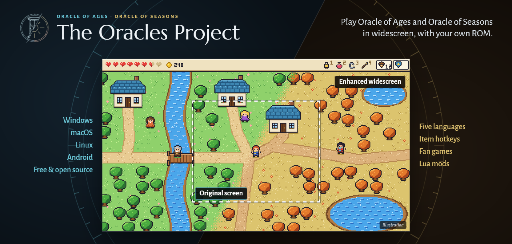
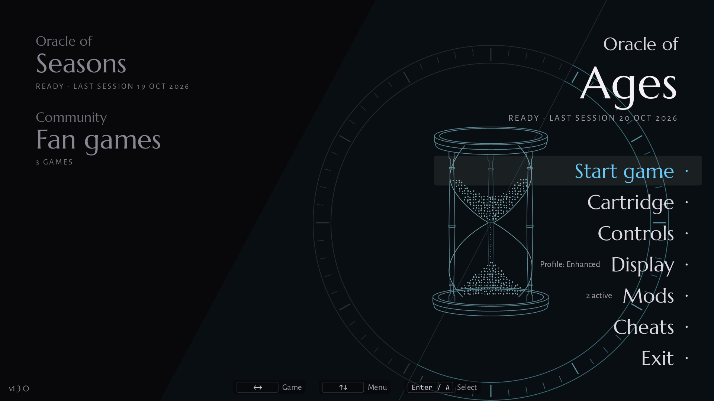
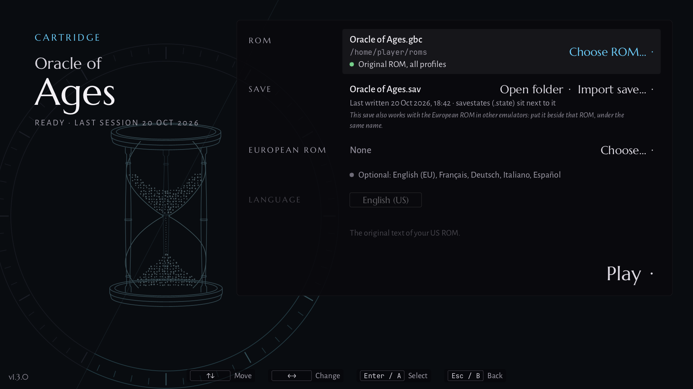

# The Oracles Project

**Play Oracle of Ages and Oracle of Seasons in widescreen, on Windows, macOS, Linux and Android.**

Your own ROM, untouched · Item hotkeys · European languages · Lua mods · Fan games

  

**[Download](https://github.com/thibautbus/top/releases/latest)** · [Getting started](#getting-started) · [FAQ](#faq) · [Fan games](docs/PLAYING.md#fan-games) · [Manual](docs/PLAYING.md) · [Report a problem](https://github.com/thibautbus/top/issues/new/choose) · [Building](docs/BUILDING.md)

## What it is

The Oracles Project runs your own ROM of Oracle of Ages or Oracle of Seasons, untouched, in a Game Boy Color emulator core, and adds what the original screen could not show: a widescreen view with the rooms around Link, options that make the game easier to play and to read, languages, mods and three fan games. Nothing of the game's code is rewritten, so it plays as it always did; [`docs/ARCHITECTURE.md`](docs/ARCHITECTURE.md) says how.

- **Widescreen**: Enhanced shows the rooms around Link in the shape of your screen, at three distances, Near, Medium and Far; Faithful keeps the original picture, 160x144, exactly what the game draws.
- **Easier to play**: item hotkeys (four keys that use or equip an item without the menu), swimming with a button held rather than tapped, continuous transitions (Link keeps walking as the screen scrolls), and cheats if you want them (no damage, ammo and rupees that never run out).
- **Easier to read**: a compact text whose letters take their own width, a wider text box, a larger text for small screens, and instant text.
- **Languages**: French, German, Italian, Spanish and the European English, taken from your own European ROM.
- **Saves**: import a save from another emulator or from the European game; on Android, export a copy to play it elsewhere.
- **Lua mods**: houses, characters who talk and minigames, which act on the game through the game's own routines and replay exactly.
- **Fan games** from their BPS patch, applied in memory to your ROM: Gifts of Kinomi and Moonrise Regalia on Oracle of Ages, Temple of Seasons on Oracle of Seasons.
- **Two emulator cores**: [SameBoy](https://sameboy.github.io/), the accurate reference, or [mGBA](https://mgba.io/)'s Game Boy core, lighter, for small devices.

## Featured in

- [icrewplay.com - Oracle of Ages e Seasons in widescreen](https://www.icrewplay.com/zelda-oracle-ages-seasons-widescreen-fan/) (Italian)
- [gamingworld.uk - Two widescreen ports of the Oracle games arrive](https://gamingworld.uk/news/two-widescreen-ports-of-zeldas-oracle-games-arrive-one-rebuilt-in-c-and-one-built-around-an-emulator)

The project is also listed on:

- [openportsgames.com](https://openportsgames.com/en/ports/the-oracles-project/)
- [playported.com](https://playported.com/ports/879-the-legend-of-zelda-oracle-of-ages/)
- [quiverlauncher.com](https://quiverlauncher.com/apps/the-legend-of-zelda-oracle-of-seasons-oracle-of-ages-the-oracles-project)
- [recomp.center](https://recomp.center/projeto/github-repository-1391290392)
- [recomp.fyi](https://recomp.fyi/game/the-legend-of-zelda-oracle-of-ages-seasons-gbc)

## Download

The [latest release](https://github.com/thibautbus/top/releases/latest) has a file for each system, ready to play with your own ROM; its notes say more about each file.

| System | File | First launch |
| --- | --- | --- |
| Windows, 64-bit | `…-windows.zip` | Unzip the folder and run `the-oracles-project.exe`. It is not signed: if SmartScreen warns, choose **More info**, then **Run anyway**. |
| macOS 11 or later, Apple Silicon and Intel | `…-macos.zip` | Unzip it and move The Oracles Project to Applications. It is not notarised. On macOS 11 to 14, right-click it the first time and choose **Open**. On macOS 15 or later, open it once, then choose **Open Anyway** in **System Settings › Privacy & Security**. |
| Linux x86_64 | `…-linux-x86_64.AppImage`, `.tar.gz` | Make it executable (`chmod +x`, or in the file's properties) and run it. If it does not start, take the `.tar.gz`, extract it and run `./the-oracles-project`. |
| Linux ARM64 (Raspberry Pi 5, Asahi Linux...) | `…-linux-arm64.AppImage`, `.tar.gz` | As on x86_64. Experimental, not yet tried on real hardware; feedback welcome. |
| Android 10 or later | `…-android.apk` | Open it to install it, allowing your browser or file manager to do so when Android asks. |

## What you need

Your own ROM of Oracle of Ages or Oracle of Seasons, from the US cartridge, which the port recognises by its SHA-1. The European ROM is needed only for the languages; a fan game needs its BPS patch, from its authors, as they distribute it, and the US ROM it is built on. A `.zip` holding the ROM or the patch works too; 7z and RAR archives do not. Any other ROM of an Oracle plays in Faithful only.

| File you provide | Expected SHA-1 |
|---|---|
| Oracle of Ages (US) | `880374fb978b18af4aa529e2e32f7ffb4d7dd2f4` |
| Oracle of Seasons (US) | `ba1268290fb2b1b70505d2d7b5825fc8a4816a4b` |
| Oracle of Ages (EU), for the languages | `9f2dff3c46406839f839a8d535353dfc1e3e8670` |
| Oracle of Seasons (EU), for the languages | `360b9408e569ba826212eac1ebea1b09573cb48c` |
| Gifts of Kinomi 1.1.2 patch (`.bps`), on Ages (US) | `bb0837fd2c62a8b3ea05da22ed6049ab57cfa1e2` |
| Moonrise Regalia 1.0.6 patch (`.bps`), on Ages (US) | `fcef50de31ce3e57d3e23cd846c0749e42098e08` |
| Temple of Seasons 1.073 patch (`.bps`), on Seasons (US) | `0646e0a8fd6830198e453fdfeeea4a0a7c01cdf4` |

## Getting started

1. **Install** the file for your system (above), and open The Oracles Project. The home screen lists Oracle of Ages, Oracle of Seasons and Fan games: the arrows or the d-pad choose, Enter or A opens, Escape or B goes back, and the mouse and touch work too.
2. **Choose a game**, then **Cartridge** in its menu.
3. **Choose ROM…** and pick your ROM (a fan game asks for its patch too); on a computer, dropping the file on the window does the same. The page says whether the port recognises it.
4. **Play**, at the bottom of the page, or **Start game** in the game's menu. The game starts in Enhanced, the widescreen view; **Display** changes the view, the window and the quality.

In the game, the arrows move Link, X is A, Z is B, Enter is Start and Backspace is Select; Escape, or L3 on a controller, opens the pause menu. Your save is written beside your ROM, under its name (`Oracle of Ages.sav` for `Oracle of Ages.gbc`), in the format other emulators use. The [manual](docs/PLAYING.md) has every page, key and setting.

## FAQ

**Which ROM do I need?** Your own dump of the US cartridge of Oracle of Ages or Oracle of Seasons, which the port checks by its SHA-1 ([What you need](#what-you-need)); a `.zip` holding it works too, 7z and RAR do not. The European ROM is needed only for the languages, and is chosen on the game's **Cartridge** page beside the US one. Any other ROM of an Oracle plays in Faithful only.

**Which device can run it?** On a computer, **Display › Quality** starts on Max, the farthest view on the accurate core; on Android, on High or Medium, by the device's processor and memory. On any system, after a game that ran slowly, the home screen suggests a lighter quality. On a Steam Deck, run the Linux AppImage, added to Steam as a non-Steam game so that the Deck's controls reach the port.

**How do I bring my save from another emulator?** Open the game's **Cartridge** page and choose **Import save…**. It takes a `.sav` from another emulator, another device or the European game, keeps the save it replaces in a `Backups` folder beside it, and refuses a file that is not a save of that game. On Android, **Export save…** puts a copy where you choose. [Saves](docs/PLAYING.md#saves) says more.

**Will an update keep my saves and settings?** Yes. Your saves stay beside your ROMs and your settings in your user folder, so the new version finds both: on Windows, unzip it where you like; on macOS and Linux, put it in place of the old one; on Android, install the new APK over the old one. On Android, 1.1.0 and earlier were a different application, which the new one installs beside and does not read: copy your save from the old application's `files/roms` folder over USB, bring it in with **Import save…**, then uninstall the old application. Each release's notes say whether the savestates (F5) of the version before still load. The home screen says when a newer version is out.

**Where do I get the fan games?** From their authors, as BPS patches. The port needs the exact versions in the table of [What you need](#what-you-need), and applies the patch in memory to your own US ROM: the game's **Cartridge** page asks for both files. [Fan games](docs/PLAYING.md#fan-games) says more.

**Something went wrong: what should I send?** Open an [issue](https://github.com/thibautbus/top/issues/new/choose) with your system, your device, the version (at the bottom left of the home screen) and the log, and never a ROM. On Windows, a console window opens with the launcher: play until the problem shows, choose **Quit to launcher** in the pause menu, which writes the end-of-game report, then copy the console's text before you close the launcher, since closing the console closes the launcher too. On macOS and Linux, start the launcher from a terminal and copy what it prints. On Android, it is `Android/data/org.theoraclesproject/files/the-oracles-project.log`, reachable from a computer over USB.

## Building from source

The port builds with CMake on Linux, macOS, Windows (MSYS2 UCRT64) and Android, and the CI builds and tests all four on every pull request: [`docs/BUILDING.md`](docs/BUILDING.md). This repository holds no ROM, no asset and no code of the games, and the CI checks that no byte of a ROM enters it.

## Documentation

| Document | For |
| --- | --- |
| [`docs/BUILDING.md`](docs/BUILDING.md) | building on each platform, the options, the tests, releasing |
| [`docs/PLAYING.md`](docs/PLAYING.md) | the manual: the launcher's pages, the keys, the saves, the fan games, Android |
| [`docs/REFERENCE.md`](docs/REFERENCE.md) | the command line, every setting of `settings.txt`, the options in detail, the log |
| [`docs/MODDING.md`](docs/MODDING.md) | writing a mod in Lua |
| [`docs/ROUTES.md`](docs/ROUTES.md) | recorded routes, the differential harness, the route suite |
| [`docs/ARCHITECTURE.md`](docs/ARCHITECTURE.md) | the layers, the rules between them, the SameBoy strategy |
| [`docs/GAME_HOOKS.md`](docs/GAME_HOOKS.md) | what the host hooks in the game and where it may write |
| [`docs/ROM_DATA_FORMATS.md`](docs/ROM_DATA_FORMATS.md) | the formats of the ROM's data |
| [`CONTRIBUTING.md`](CONTRIBUTING.md) | the rules of the code and of a change |
| [`docs/README.md`](docs/README.md) | every document, by reader |

## AI-assisted development

This repository was developed with AI assistance. Every change, whoever writes it, is held by the same checks: the tests the CI runs without a ROM, the route suite replayed on the games with its run hashes kept, the text and boundary checks, and a review before it is merged.

## Credits

- [oracles-disasm](https://github.com/Stewmath/oracles-disasm), the disassembly of both games by Stewmath and its contributors: the addresses and symbol names the host reads and hooks are generated from its symbol files.
- [SameBoy](https://sameboy.github.io/) by Lior Halphon: the emulator core the game runs in, unmodified, the accurate one.
- [mGBA](https://mgba.io/) by Vicki Pfau and its contributors: the lighter core the game can run in, for small devices.
- The fan games the port recognises, and their authors:
  - Gifts of Kinomi, by ZerotoKoops, Stewmath, Gamma and Ralfaro;
  - Moonrise Regalia, by PontiusStone;
  - Temple of Seasons, by Jay (like the bird, not the letter) and Ralfaro.

## Licence

The port is under the MIT licence ([`LICENSE`](LICENSE)). It vendors or embeds, each under its own licence, shipped with the binaries:

- [SameBoy](third_party/sameboy/) (Expat/MIT), the emulator core;
- [mGBA](third_party/mgba/)'s Game Boy core (Mozilla Public License 2.0), with one patch, and the [inih](third_party/mgba/core/src/third-party/inih/) it uses (BSD 3-Clause), the lighter emulator core;
- [Lua](third_party/lua/) (MIT), the mods' runtime;
- [SDL 3](https://libsdl.org/) (zlib), built from the release pinned in `config/sdl3.json`;
- [stb_truetype](third_party/stb/) (MIT or public domain) and [NanoSVG](third_party/nanosvg/) (zlib), the launcher's text and motifs;
- the fonts [Marcellus](third_party/fonts/marcellus/), [Alegreya Sans](third_party/fonts/alegreya-sans/) and [JetBrains Mono](third_party/fonts/jetbrains-mono/) (SIL Open Font Licence);
- the Gradle wrapper of the Android build (Apache 2.0).

Oracle of Ages and Oracle of Seasons are Nintendo's; this project is not affiliated with Nintendo. The fan games are their authors'.

## Contributors ✨

Thanks go to these wonderful people:

<!-- ALL-CONTRIBUTORS-LIST:START - Do not remove or modify this section -->
<table>
  <tr>
    <td align="center" valign="top" width="14.28%"><a href="https://github.com/thibautbus"> <b>thibautbus</b></a> <a href="https://github.com/thibautbus/top/commits?author=thibautbus" title="Code">💻</a> <a href="https://github.com/thibautbus/top/commits?author=thibautbus" title="Documentation">📖</a> <a href="https://github.com/thibautbus/top/commits?author=thibautbus" title="Maintenance">🚧</a></td>
    <td align="center" valign="top" width="14.28%"><a href="https://github.com/Theeohn"> <b>Theeohn</b></a> <a href="#userTesting-Theeohn" title="User Testing">📓</a></td>
    <td align="center" valign="top" width="14.28%"><a href="https://github.com/SiggeMcKvack"> <b>SiggeMcKvack</b></a> <a href="https://github.com/thibautbus/top/commits?author=SiggeMcKvack" title="Code">💻</a></td>
  </tr>
</table>

<!-- ALL-CONTRIBUTORS-LIST:END -->
