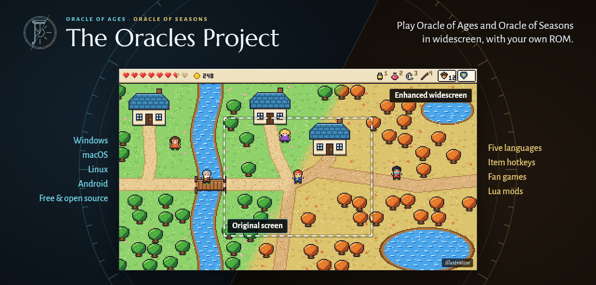

<div align="center">

# The Oracles Project

**Play Oracle of Ages and Oracle of Seasons in widescreen, on Windows, macOS, Linux and Android.**

Your own ROM, untouched · Item hotkeys · Five languages · Lua mods · Fan games

[](https://github.com/thibautbus/top/releases) [](https://github.com/thibautbus/top/releases) [](#contributors-)

**[Download](https://github.com/thibautbus/top/releases/latest)** · [Features](#features) · [Fan games](docs/PLAYING.md#fan-games) · [Manual](docs/PLAYING.md) · [Report a problem](https://github.com/thibautbus/top/issues) · [Building](docs/BUILDING.md)



</div>

## Features

A faithful, moddable port of Oracle of Ages and Oracle of Seasons for Windows, macOS, Linux and Android. Your own ROM runs in an emulator core, [SameBoy](https://sameboy.github.io/), unmodified, the accurate reference, or [mGBA](https://mgba.io/)'s Game Boy core, lighter, for small devices (Display's Core); around it, a native host observes the game and presents it:

- **Faithful**: the original image, 160x144, exactly what the game draws;
- **Enhanced**: a widescreen view with the neighbouring rooms, which the game itself computes in a second instance of the core, a smooth camera, and the status bar repositioned in a band of its own;
- **gameplay options**: continuous transitions (Link keeps walking through the scrolling transitions), item hotkeys (four keys that use or equip an item without the menu), swimming with a button held rather than tapped (the flippers' A, Ages' mermaid suit), cheats (no damage, ammo and rupees that never run out), and a drawn-back view that shows three rooms across and two down outdoors;
- **languages and text**: French, German, Italian, Spanish and the European English, taken from your own European ROM; a compact text whose letters take their own width, a wider text box, a larger text for small screens, and instant text;
- **saves**: import a save from another emulator or from the European game, and export a copy to play it elsewhere;
- **Lua mods**: houses, characters who talk and minigames, which act on the game through the game's own routines and replay exactly;
- **fan games** from their BPS patch, applied in memory to your ROM:
  - Gifts of Kinomi 1.1.2, built on Oracle of Ages;
  - Moonrise Regalia 1.0.6, built on Oracle of Ages;
  - Temple of Seasons 1.073, built on Oracle of Seasons.

Nothing of the game's code is rewritten: the game runs as it is, and the host reads its state. [`docs/ARCHITECTURE.md`](docs/ARCHITECTURE.md) says why.

## Featured in

- [icrewplay.com - Oracle of Ages e Seasons in widescreen](https://www.icrewplay.com/zelda-oracle-ages-seasons-widescreen-fan/) (Italian)
- [gamingworld.uk - Two widescreen ports of the Oracle games arrive](https://gamingworld.uk/news/two-widescreen-ports-of-zeldas-oracle-games-arrive-one-rebuilt-in-c-and-one-built-around-an-emulator)

The project is also listed on:

- [quiverlauncher.com](https://quiverlauncher.com/apps/the-legend-of-zelda-oracle-of-seasons-oracle-of-ages-the-oracles-project)
- [recomp.fyi](https://recomp.fyi/game/the-legend-of-zelda-oracle-of-ages-seasons-gbc)
- [openportsgames.com](https://openportsgames.com/en/ports/the-oracles-project/)

## Download

The [latest release](https://github.com/thibautbus/top/releases/latest) has the port ready to play with your own ROM, for Windows, macOS (Apple Silicon and Intel), Linux and Android 10 or later. On Linux, take the AppImage, `the-oracles-project-X.Y.Z-linux-x86_64.AppImage`: make it executable (`chmod +x`) and run it. If the AppImage does not start, use the `.tar.gz`, a folder that runs once extracted, or run the AppImage with `--appimage-extract-and-run`. Linux ARM64 (Raspberry Pi 5, Asahi Linux...) has the same two files, `-linux-arm64`: experimental, not yet tried on real hardware; feedback welcome. The release notes say how to install each file.

## Quick start

On Linux, with a C11 compiler, CMake 3.19 or later and the development packages SDL 3 builds against (or an installed SDL 3):

```bash
cmake -S . -B build -DBUILD_TESTING=ON
cmake --build build --parallel
ctest --test-dir build --output-on-failure
```

Then run the launcher, and choose your ROM on its Cartridge page, or start a game directly:

```bash
build/the-oracles-project
build/the-oracles-project --rom "/path/to/Oracle of Ages.gbc" --enhanced
```

macOS, Windows (MSYS2) and Android are in [`docs/BUILDING.md`](docs/BUILDING.md); the launcher, the options, the keys and the settings in [`docs/PLAYING.md`](docs/PLAYING.md).

## What this repository does not contain

No ROM, no asset of the games, no data decompressed from a ROM, no code of the games. You provide your own ROM of Oracle of Ages or Oracle of Seasons (US); a fan game needs that ROM and the game's own BPS patch. The addresses and symbol names the host uses come from the [oracles-disasm](https://github.com/Stewmath/oracles-disasm) disassembly, at the commit pinned in `config/disasm.json`, through tables generated from its symbol files; the CI audits that no ROM byte enters the repository. Tests that need a ROM are skipped without one, never simulated.

The port recognises these files by their SHA-1; a patch's is the file as its authors distribute it (the port checks the image it makes), and a `.zip` is recognised by the one ROM or patch it holds:

| File you provide | Expected SHA-1 |
|---|---|
| Oracle of Ages (US) | `880374fb978b18af4aa529e2e32f7ffb4d7dd2f4` |
| Oracle of Seasons (US) | `ba1268290fb2b1b70505d2d7b5825fc8a4816a4b` |
| Oracle of Ages (EU), for the languages | `9f2dff3c46406839f839a8d535353dfc1e3e8670` |
| Oracle of Seasons (EU), for the languages | `360b9408e569ba826212eac1ebea1b09573cb48c` |
| Gifts of Kinomi 1.1.2 patch (`.bps`), on Ages (US) | `bb0837fd2c62a8b3ea05da22ed6049ab57cfa1e2` |
| Moonrise Regalia 1.0.6 patch (`.bps`), on Ages (US) | `fcef50de31ce3e57d3e23cd846c0749e42098e08` |
| Temple of Seasons 1.073 patch (`.bps`), on Seasons (US) | `0646e0a8fd6830198e453fdfeeea4a0a7c01cdf4` |

## Platforms

- Linux and macOS (Intel and Apple Silicon), with SDL 3;
- Windows, built with MSYS2 UCRT64;
- Android 10 and later (`arm64-v8a`, `x86_64`), with touch controls, the same launcher and the same options.

The CI builds and tests all four on every pull request.

## Documentation

| Document | For |
| --- | --- |
| [`docs/BUILDING.md`](docs/BUILDING.md) | building on each platform, the options, the tests, releasing |
| [`docs/PLAYING.md`](docs/PLAYING.md) | the launcher, the fan games, the command line, the profiles and options, the settings |
| [`docs/MODDING.md`](docs/MODDING.md) | writing a mod in Lua |
| [`docs/ROUTES.md`](docs/ROUTES.md) | recorded routes, the differential harness, the route suite |
| [`docs/ARCHITECTURE.md`](docs/ARCHITECTURE.md) | the layers, the rules between them, the SameBoy strategy |
| [`docs/GAME_HOOKS.md`](docs/GAME_HOOKS.md) | what the host hooks in the game and where it may write |
| [`docs/ROM_DATA_FORMATS.md`](docs/ROM_DATA_FORMATS.md) | the formats of the ROM's data |
| [`CONTRIBUTING.md`](CONTRIBUTING.md) | the rules of the code and of a change |

## AI-assisted development

This repository was developed with AI assistance. Every change, whoever writes it, is held by the same checks: the tests the CI runs without a ROM, the route suite replayed on the games with its run hashes kept, the text and boundary checks, and a review before it is merged.

## Credits

- [oracles-disasm](https://github.com/Stewmath/oracles-disasm), the disassembly of both games by Stewmath and its contributors: the addresses and symbol names the host reads and hooks are generated from its symbol files.
- [SameBoy](https://sameboy.github.io/) by Lior Halphon: the emulator core the game runs in, unmodified, the accurate one.
- [mGBA](https://mgba.io/) by Vicki Pfau and its contributors: the lighter core the game can run in, for small devices.
- The fan games the port recognises, and their authors:
  - Gifts of Kinomi, by ZerotoKoops, Stewmath, Gamma and Ralfaro;
  - Moonrise Regalia, by PontiusStone;
  - Temple of Seasons, by Jay (like the bird, not the letter) and Ralfaro.

## Licence

The port is under the MIT licence ([`LICENSE`](LICENSE)). It vendors or embeds, each under its own licence, shipped with the binaries:

- [SameBoy](third_party/sameboy/) (Expat/MIT), the emulator core;
- [mGBA](third_party/mgba/)'s Game Boy core (Mozilla Public License 2.0), with one patch, and the [inih](third_party/mgba/core/src/third-party/inih/) it uses (BSD 3-Clause), the lighter emulator core;
- [Lua](third_party/lua/) (MIT), the mods' runtime;
- [SDL 3](https://libsdl.org/) (zlib), built from the release pinned in `config/sdl3.json`;
- [stb_truetype](third_party/stb/) (MIT or public domain) and [NanoSVG](third_party/nanosvg/) (zlib), the launcher's text and motifs;
- the fonts [Marcellus](third_party/fonts/marcellus/), [Alegreya Sans](third_party/fonts/alegreya-sans/) and [JetBrains Mono](third_party/fonts/jetbrains-mono/) (SIL Open Font Licence);
- the Gradle wrapper of the Android build (Apache 2.0).

Oracle of Ages and Oracle of Seasons are Nintendo's; this project is not affiliated with Nintendo. The fan games are their authors'.

## Contributors ✨

Thanks go to these wonderful people:

<!-- ALL-CONTRIBUTORS-LIST:START - Do not remove or modify this section -->
<table>
  <tr>
    <td align="center" valign="top" width="14.28%"><a href="https://github.com/thibautbus"><br /><sub><b>thibautbus</b></sub></a><br /><a href="https://github.com/thibautbus/top/commits?author=thibautbus" title="Code">💻</a> <a href="https://github.com/thibautbus/top/commits?author=thibautbus" title="Documentation">📖</a> <a href="https://github.com/thibautbus/top/commits?author=thibautbus" title="Maintenance">🚧</a></td>
    <td align="center" valign="top" width="14.28%"><a href="https://github.com/Theeohn"><br /><sub><b>Theeohn</b></sub></a><br /><a href="#userTesting-Theeohn" title="User Testing">📓</a></td>
    <td align="center" valign="top" width="14.28%"><a href="https://github.com/SiggeMcKvack"><br /><sub><b>SiggeMcKvack</b></sub></a><br /><a href="https://github.com/thibautbus/top/commits?author=SiggeMcKvack" title="Code">💻</a></td>
  </tr>
</table>

<!-- ALL-CONTRIBUTORS-LIST:END -->
