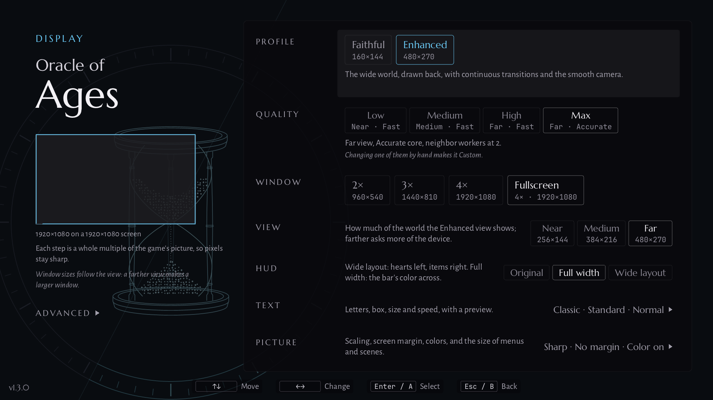

# Playing

The manual of The Oracles Project: what each page of the launcher does, and how the game plays with it. The command line, every key of `settings.txt` and each option in full detail, for route authors and anyone who edits the settings by hand, are in [`REFERENCE.md`](REFERENCE.md).

- [What you need](#what-you-need)
- [Getting started](#getting-started)
- [The home screen](#the-home-screen)
- [Cartridge](#cartridge)
- [Display](#display): [Faithful and Enhanced](#faithful-and-enhanced), [View](#view), [HUD](#hud), [The camera](#the-camera), [Display › Text](#display--text), [Display › Picture](#display--picture), [Unvisited rooms](#unvisited-rooms), [Display › Advanced](#display--advanced)
- [Controls](#controls)
- [Gameplay options](#gameplay-options): [Continuous transitions](#continuous-transitions), [Hold to swim](#hold-to-swim), [Item hotkeys](#item-hotkeys)
- [Cheats](#cheats)
- [Languages](#languages)
- [Mods](#mods)
- [Fan games](#fan-games)
- [In game](#in-game): [the pause menu](#the-pause-menu), [keys](#keys), [savestates](#savestates)
- [Saves](#saves)
- [Android](#android)
- [Troubleshooting](#troubleshooting)
- [Reporting a problem](#reporting-a-problem)
- [About and privacy](#about-and-privacy)

## What you need

- Your own ROM of Oracle of Ages or Oracle of Seasons, from the US cartridge. The port recognises the original US ROMs by their SHA-1, which the [README](../README.md) lists, and plays them with every option.
- Another ROM of an Oracle, such as a hack or a randomizer seed, plays too, in Faithful only: without the wide view and without the gameplay options.
- A `.zip` that holds the ROM works as well as the ROM itself. 7z and RAR archives are not read.
- For the languages, the European ROM of the same game ([Languages](#languages)).
- For a fan game, its BPS patch in the version listed under [Fan games](#fan-games), and the ROM of the Oracle it is built on.

## Getting started

1. Download the file for your system from the [latest release](https://github.com/thibautbus/top/releases/latest):
   - **Windows**: unzip the folder and run `the-oracles-project.exe`. The executable is not signed, so SmartScreen may warn the first time: **More info**, then **Run anyway**.
   - **macOS**: unzip it and move The Oracles Project to Applications. It is not notarised. On macOS 11 to 14, right-click it the first time and choose **Open**. On macOS 15 or later, open it once, then choose **Open Anyway** in **System Settings › Privacy & Security** and confirm.
   - **Linux**: make the AppImage executable and run it. If it does not start, take the `.tar.gz` instead and run `./the-oracles-project` from its folder.
   - **Android**: install the APK, allowing your browser or file manager to install it when Android asks.
2. Open the launcher. The home screen lists Oracle of Ages, Oracle of Seasons and Fan games.
3. Pick a game, open **Cartridge** and choose its ROM with **Choose ROM…**, or drop the ROM's file on the window.
4. Choose **Play** at the bottom of Cartridge, or **Start game** in the game's menu.

The game starts in Enhanced, the wide view, in fullscreen; [Display](#display) changes the view, the window and the quality. Its save is written beside the ROM, under the same name: `Oracle of Ages.sav` for `Oracle of Ages.gbc`, in the format other emulators use.

## The home screen

The home screen has three entries: **Oracle of Ages**, **Oracle of Seasons** and **Fan games**. The chosen entry shows its title, its state and its menu. The state is **Ready** (with the date of the last session), **ROM not found**, or for a fan game whose Oracle's ROM is chosen, **Patch not found**.

A game's menu has **Start game**, **Cartridge**, **Controls**, **Display**, **Mods**, **Cheats** (not for a fan game or an unrecognised ROM) and **Exit**. Cartridge names the language beside it when it is not English (US), Display the profile the game plays in, and Mods how many mods are on. **Fan games** lists Gifts of Kinomi, Moonrise Regalia and Temple of Seasons, each with its state; a fan game picked has the same menu, with Mods greyed and no Cheats. A greyed entry says why when it is highlighted.

Move with the arrows, Enter and Escape on the keyboard; with the d-pad, A and B on a controller, where the menu's button and Guide act as Escape; or with the mouse, or by touch. **F11** switches fullscreen on and off. The key hints at the bottom of each page, the pause menu's included, show the keys of the device you used last.

Its Cartridge page asks for both: **Base ROM** is the ROM of its Oracle (Ages' for Gifts of Kinomi and Moonrise Regalia, Seasons' for Temple of Seasons), the same the Oracle's page shows and changes, chosen once for the Oracle and every game made on it; **Patch** is the game's `.bps` file, or a `.zip` of it (**Choose patch…**), read as a BPS patch whose checksums hold, and refused when it is another fan game's, which makes that game from the base ROM ("Refused: the patch of Moonrise Regalia, not of Gifts of Kinomi."), the patch kept before it staying; before one is chosen, the page names the patch the game expects ("No patch: the BPS patch of Moonrise Regalia 1.0.6 is expected"). Below, its folder and the image the two make, built in memory as the session builds it: recognised, unrecognised (Faithful only), refused with the reason (a patch made for another base, another fan game's patch written in `settings.txt`), or "The game needs both files." A patch dropped on a fan game's page becomes its patch, unless it is another fan game's; dropped elsewhere, it goes to the fan game whose image it makes from its Oracle's ROM already chosen. The save goes beside the patch, under its name (`Moonrise Regalia 1.0.6.sav`), not beside the base ROM, which the Oracle's own save uses; Open folder opens the patch's folder.
The launcher opens in a 16:9 window of 1280x720 the first time. The window can be resized, and its size is remembered. A window or a screen nearer 4:3 than 16:9, such as a 640x480 handheld or a 1024x768 monitor, takes the 4:3 layout: the three entries become tabs along the top, each page lays its rows in one column, and Controls splits into three tabs, **Buttons**, **Hotkeys** and **In game**.

When a newer version is out, the home screen says so beside the version number at the bottom left ("· 1.3.0 available"). Down from **Exit** reaches the notice, then the version number; the notice opens the release page in your browser, and the version number opens [About](#about-and-privacy).

## Cartridge

| Row | Choices | What it does |
| --- | --- | --- |
| **ROM** (a fan game: **Base ROM**) | **Choose ROM…** | The game's ROM, a `.zip` holding it too, or a file dropped on the window. Its status: an original ROM plays every profile, an unrecognised one Faithful only, a refused one says why. |
| **Patch** (fan games) | **Choose patch…** | The fan game's BPS patch, or a `.zip` holding it. |
| **European ROM** (Ages, Seasons) | **Choose…**, then **Change…** and **Remove** | Optional: the European ROM of the same game, which the languages come from. |
| **Language** (Ages, Seasons) | English (US), English (EU), and French, German, Italian and Spanish, each named in its own language | The text the game plays in. English (US) is the cartridge's; the others need the European ROM. |
| **Save** | **Open folder** and **Import save…**; on Android **Export save…** and **Import save…** | The game's save and its date ([Saves](#saves)). |
| **Play** | | Starts the game. |

**Choose ROM…** opens the system's file dialog: on Linux the desktop's, or zenity's where it is installed. Without one, the launcher asks you to drop the file on the window. Dropping a file works everywhere: on a game's Cartridge page it is that game's ROM, or the patch on a fan game's page, and on the home screen the launcher recognises the game and files the ROM under it.

A ROM, a European ROM or a patch may come as a `.zip`. The zip must hold one ROM (a `.gbc` or `.gb` file) or one patch (a `.bps` file); its other files, such as a readme, are left aside. A zip of several ROMs, an encrypted zip, or a 7z or RAR archive is refused, and the page says why. The save of a zipped ROM goes beside the zip, under its name.

The launcher remembers each game's ROM. A refused ROM shows its reason and is not remembered. Cartridge is on the home screen only: a game takes its ROM, its language and its save when it starts. The exact rules for files and zips are in [`REFERENCE.md`](REFERENCE.md#roms-patches-and-zips).

## Display

| Row | Choices | Default | What it does | Plays in | From the pause |
| --- | --- | --- | --- | --- | --- |
| **Profile** | Faithful, Enhanced | Enhanced | Faithful shows the game's own screen, 160x144. Enhanced shows the wide view, with the rooms around Link. | both | greyed |
| **Quality** | Low, Medium, High, Max; Custom when set by hand | the device's | Sets **View**, **Core** and **Neighbor workers** in one choice: Low is Near on Fast, Medium is Medium on Fast, High is Far on Fast, Max is Far on Accurate with two workers. | Enhanced | greyed |
| **Window** | 2x, 3x, 4x, Fullscreen | Fullscreen | The window's size, a whole multiple of the game's picture so that pixels stay sharp. Greyed where the screen holds one size only, and on Android, which plays fullscreen. | both | at once; smaller windows from the home screen only |
| **View** | Near, Medium, Far | by Quality | How much of the world the wide view shows; farther asks more of the device. | Enhanced | greyed |
| **HUD** | Original, Full width, Wide layout | Full width | The status bar: as the game draws it between two dark bands, its colour across the whole width, or laid out with the hearts on the left and the items on the right. | Enhanced | at once |
| **Text** | › | | Opens [Display › Text](#display--text). | | |
| **Picture** | › | | Opens [Display › Picture](#display--picture). | | |
| **Advanced** | › | | Opens [Display › Advanced](#display--advanced). | | |

Its Cartridge page asks for both: **Base ROM** is the ROM of its Oracle (Ages' for Gifts of Kinomi and Moonrise Regalia, Seasons' for Temple of Seasons), the same the Oracle's page shows and changes, chosen once for the Oracle and every game made on it; **Patch** is the game's `.bps` file, or a `.zip` of it (**Choose patch…**), read as a BPS patch whose checksums hold; before one is chosen, the page names the patch the game expects ("No patch: the BPS patch of Moonrise Regalia 1.0.6 is expected"). Below, its folder and the image the two make, built in memory as the session builds it: recognised, unrecognised (Faithful only), refused with the reason (a patch made for another base), or "The game needs both files." A patch dropped on a fan game's page becomes its patch; dropped elsewhere, it goes to the fan game whose image it makes from its Oracle's ROM already chosen. The save goes beside the patch, under its name (`Moonrise Regalia 1.0.6.sav`), not beside the base ROM, which the Oracle's own save uses; Open folder opens the patch's folder.
Display holds for every game the home screen starts, and its choices apply at the next **Play**. The tables say which rows also change from the pause. The sizes Display shows, and its diagram, are those the game will take on the screen the window is on. A window too large for the screen with its title bar is reduced when the game starts, and Display says so.

**Quality** sets **View**, **Core** and **Neighbor workers** at once, for the device. The first opening takes a quality for the device: Max on computers; on Android, High on a device of 8 processor threads and 6 GB of memory or more, Medium otherwise. Changing one of the three rows by hand makes the quality **Custom**, which shows but cannot be picked; picking a quality sets all three again.

After a game in Enhanced that ran slowly, the home screen suggests the quality just lighter, in a notice at the bottom left: "The game ran slowly at High: Medium may play smoother." Under Custom, it suggests a nearer view. Nothing changes by itself: a click on the notice opens Display on that row. The suggestion comes once for a quality, until you change the view, the core or the workers.

**Text** and **Picture** sum up their rows beside them, as "Compact · Wide · Normal" or "Sharp · No margin · Color on", with " · Instant" after Text when the text speed is Instant.

### Faithful and Enhanced

**Faithful** shows the game's own screen, 160x144, exactly as the game draws it.

**Enhanced** shows the game in a wide view. The rooms around Link are drawn beside the one he is in, so that the world reads as one piece, and the camera follows him. The neighbouring rooms are computed by the game itself, in a second copy of it that runs in the background: a room not ready yet stays black for a moment, never wrong. The rooms nearest Link come first; in the drawn-back views, the far corners of the view follow before a room change brings them in, and in Ages' sea the rooms on the other side of the surface, below Link as he swims or above him under water, are ready sooner for a dive or a return to the surface. Their people and objects stand where the game puts them; those that move in place, such as villagers, flowers and fountains, move there too, while enemies keep their pose, and at the Low quality everything there stays still.

A dungeon's large room shows whole, and an interior of one room is centred. The game's menus, map, cutscenes and file screen show framed in the middle, at the view's scale or larger with **Display › Picture › Menus & scenes**. **F3** switches between the wide view and the game's own screen, framed.

An unrecognised ROM, such as a hack, plays in Faithful whatever the profile chosen, and Display says so.

### View

**View** chooses how much of the world Enhanced shows, in the shape of your screen:

| View | 16:9 screen | 4:3 screen | Outdoors |
| --- | --- | --- | --- |
| **Near** | 256x144 | 213x160 | more than a room across |
| **Medium** | 384x216 | 320x240 | two rooms across or more |
| **Far** | 480x270 | 480x360 | three rooms across and two down (nearly three in 4:3) |

Far is the default. In Near on a 4:3 screen, which is narrower than a dungeon's large room, the view follows Link inside the room rather than showing it whole. The farther the view, the more work for the device: on a small handheld, Medium may play smoothly where Far does not.

On a screen that Far's usual size fills badly, Far takes a size made for it, with as much of the world as the screen allows. That is 426x320 on a 1280x960 screen (a Retroid Pocket Nova, an Anbernic RG477M, a Retroid Pocket Mini) and 412x360 on 1240x1080 (a Retroid Pocket Mini V2 or Classic, an AYN Thor's bottom screen): a little less than three rooms across, but at a larger scale. On those screens only, **Display › Picture › Far size** chooses that size (Fitted) or Far's usual one (Fixed). The view's sizes and their rules are in [`REFERENCE.md`](REFERENCE.md#the-views-sizes).

### HUD

**HUD** draws the game's status bar in one of three ways, in Enhanced:

- **Original**: as the game draws it, 160 pixels wide, between two dark bands;
- **Full width**, the default: across the whole view, the bands beside it taking the bar's own colour as the game changes it;
- **Wide layout**: across the whole view, the hearts and the money at the left, the items of B and A at the right, and the item hotkeys' slots just before B. The hearts take one row where the view is wide enough (Medium and Far), the game's two rows in Near, and in Medium on a 4:3 screen while the hotkeys' hotbar shows. In Near on a 4:3 screen the slots do not fit and are not drawn; the hotkeys work all the same.

The bar never covers the world, and the game's menus and cutscenes keep it centred. A change applies at once, from the pause too.

### The camera

In Enhanced the camera follows Link at his own speed, steady on stairs as on flat ground, and settles as soon as he stops, his sprite steady on the screen. When the game puts Link back somewhere else, after a fall or a whirlpool, the camera finds him again quickly, and it does not run ahead into a neighbouring room that is still being prepared. **Display › Advanced › Camera** chooses how finely it moves. **Smooth** moves it by fractions of a pixel at your screen's resolution, so that diagonal walks, swims across the sea floor and stairs glide, in a dungeon's large rooms as outdoors. **Pixel** keeps the game's whole pixels.
In Enhanced the camera follows Link and comes to rest without stepping back. **Display › Advanced › Camera** chooses how finely it moves. **Smooth** moves it by fractions of a pixel at your screen's resolution, so that diagonal walks, swims across the sea floor and stairs glide. **Pixel** keeps the game's whole pixels.

Smooth is the default on computers. On Android, it is the default where the game is shown at three times its size or more, as in every view on a 1080-line screen, and Pixel is the default below that. A choice applies at once, from the pause too. Where the game is shown at less than twice its size, the row says that it has no effect there.

### Display › Text

| Row | Choices | Default | What it does | Plays in | From the pause |
| --- | --- | --- | --- | --- | --- |
| **Text** | Classic, Compact | Classic | Classic: the game's fixed-width letters. Compact: each letter takes its own width, so more words fit on a line and a dialogue takes fewer boxes. A savestate taken with Compact needs Compact. | Enhanced; Ages, Seasons and the fan games | greyed |
| **Text box** | Standard, Wide | Standard | Standard: the game's box. Wide: a longer box with longer lines, fewer boxes still with Compact. A savestate taken with Wide needs Wide. | Enhanced; Ages and Seasons | greyed |
| **Text size** | Normal, Large, Very large | Normal | Draws the text box larger where the view has room for it, the next size down where it has not, for reading from a distance or on a small screen. | Enhanced; Ages and Seasons | at once |
| **Text speed** | Classic, Instant | Classic | Classic: letter by letter, at the speed chosen on the game's file screen. Instant: each line appears whole; A still turns the page. | both; not on an unrecognised ROM | when the game resumes |

The page shows a preview of the view the game will play in: the status bar at the top, and the text box at the bottom at the size it will take there, in the font of your ROM (bars stand in for the text without a ROM). Where the view has no room for the size chosen, the preview says which size it falls back to.

**Text** and **Text box** are laid out when the game starts, so they change from the home screen only. A fan game has the compact text, but not yet the wide box or the larger sizes: its page greys them, "Ages and Seasons only for now.". **Text speed** changes the game's pace rather than its picture, so it plays in Faithful too. With Instant, A still turns the page: if you are used to pressing A twice, the second press turns the next page. A few texts the game shows slowly on purpose still begin letter by letter.

Each option is detailed in [`REFERENCE.md`](REFERENCE.md#the-compact-text): the compact text, the wide text box, the text size and the text speed.

### Display › Picture

**Enhanced** shows a wide surface, 256x144: the status bar in a band of sixteen lines at the top, centred, and below it the world, the play area placed by a smooth camera in world coordinates with the neighbouring rooms drawn around it. The neighbours are computed by the game itself in a second instance of the core; a neighbour not ready yet is black, never a wrong terrain. Their characters and objects stand where the game creates them when Link enters; those that move in place (villagers marking time, flowers, fountains) do so in the neighbours too, enemies keep their pose, and the Low quality keeps them all still. Large rooms (dungeons) are shown whole, centred, their scrolls sliding the band; interiors of one room are centred and still. Menus, cutscenes and the file select show the core's image framed: at the view's scale, or alone at its own largest whole scale, as Faithful shows it, with `menus=large` in the settings (Display › Picture's Menus & scenes), the default on Android, where the view's scale on a small screen makes them hard to read (`menus=view` keeps the view's), which changes from the pause too, at once; a room's load (a door, stairs: the room left's last frames, the reveal, Link walking in until the camera takes him) stays at the view's scale, the status bar's band at the top as in play (its background, the hotbar) and below it the play area alone, where the world shows it before and after (but a room Link walks into from its edge, which the camera frames once he is in), the screen's blank between them (the LCD off, a full fade) framed as the game shows it, at the large menus' scale where it follows a screen they enlarge (a cutscene's picture fading out, the map) until the room shows. F3 toggles between the wide world and the framed core. The camera has two profiles (`--camera`, `camera=` in the settings): 1 waits for Link to cross a dead zone of sixteen pixels and catches up; 2, the default, follows Link continuously at his own speed, steady on stairs as on flat ground, and comes to rest when he stops, on the first frame he stands still with the Smooth camera (below, `subpixel_camera=`), never overshooting him nor stepping back, and when the game puts him elsewhere (back at a room's entrance after a fall or a whirlpool) it pans to him in a fraction of a second rather than gliding there; toward a neighbouring room still being prepared, it goes no further than Link himself, without looking ahead, until the room is there, so that it shows no more black than before.
| Row | Choices | Default | What it does | Plays in | From the pause |
| --- | --- | --- | --- | --- | --- |
| **Scaling** | Sharp, Fill | Sharp | Sharp: the largest whole scale, every pixel exact. Fill: the whole screen in the game's proportions, pixels slightly softer. Fullscreen only: a window keeps its whole steps. | both | at once |
| **Screen margin** | Off, Auto, Small, Large | Off | Keeps the picture clear of screen edges a device hides. Auto follows what the system reports; Small and Large keep a fixed margin at the top and the bottom. | both | at once |
| **Color correction** | Off, On | On | On: colours as the Game Boy Color's screen showed them. Off: the raw palette. Also F2 in game. | both | at once |
| **Far size** | Fitted, Fixed | Fitted | Fitted: Far takes a size made for this screen. Fixed: Far's usual size. Shown only on a screen where the two differ, such as 1280x960 or 1240x1080. | Enhanced | greyed |
| **Menus & scenes** | View, Large | Large on Android, View elsewhere | Large: the game's menus, map, cutscenes and file screen alone, at their own largest scale, easier to read on a small screen. View: at the view's scale. | Enhanced | at once |
| **Unvisited rooms** | Shown, Hidden | Shown | Hidden keeps the rooms Link has never entered dark around him, as the game's map does. | Enhanced | when the game resumes |

**Fill** applies in fullscreen only, which Android always is; in a window, the game keeps its whole steps. **Screen margin** is for a screen whose edges hide part of the picture ([Troubleshooting](#troubleshooting)). **Far size** shows only on a screen where Fitted and Fixed differ, its note giving both sizes.

### Unvisited rooms

The wide view shows the rooms around Link, rooms he may never have seen. With **Display › Picture › Unvisited rooms** on **Hidden**, a room around him that he has never entered stays dark, its people and objects with it, as the game's own map leaves blank the squares he has not visited. The view reads the same record as the map, which the save keeps: an old save shows at once the rooms already visited, and a new game starts with none.

The room Link is in always shows, and a room he enters for the first time fades in. A room visited in the other era of Ages stays dark until he enters it in this one. In a dungeon the view shows no room around him at rest, so nothing changes there. Hidden changes only the picture, never the game or its savestates. From the pause, a change applies when the game resumes.

### Display › Advanced

**A step a frame through them** (`--continuous-steps`, which Display's continuous transitions turn on; a separate option so that the routes recorded without it replay as they were played): without it, Link walks the whole scroll at a pixel a frame whether a direction is held or not, so that a tap at a room's edge takes him through the scroll by himself, and the frame that ends the scroll leaves him still for a frame, the one the game finishes the scroll in, before he goes on, as a slight catch. With the option, on foot, he goes through the transition as he would walk in the open, as the keys say: a direction held toward the edge, straight or diagonally, walks him on at the game's own speed, through a long load of the room too; with none held there, from the frame it is let go he goes on to where the game itself places him at the scroll's end, its own move of the transition (15 pixels across, 16 up or down, from where it began, the pixels he walked included, or further if he walked further), evenly up to the frame that ends the scroll, never faster than he walked, and without walking (let go late in the scroll after a diagonal, he may stop a little short of that place; let go at the end of a long load, after walking as far as the scroll's own steps take him, he stands until they start); with the diagonal, a direction held across the axis, a diagonal or square across, walks him that way too, turned to face it as the game turns him (and coming back that way after a fall in that room), onto tiles without collision, as soon as the room entered's walls are known, and never past the edge of the room entered on that side, slowing as he nears it so as to reach it as the scroll ends rather than stopping short on that side, so that at a corner the next transition carries on from where he stands. However far into the room entered he walked or swam, a whirlpool, a hole or a drowning there brings him back where the game itself would have placed him at the scroll's end. Without the option the continuous transitions leave that place where the scroll left him, which may be well into the room: a whirlpool there can take him back to it again and again. The frame that ends the scroll gives him his step, walking or swimming, as the frames before it, and the frame that starts a diagonal one his single step, where the game's own and the option's came together. Swimming and on Ages' sea floor, his motion is the game's, as without it. A savestate does not count it. Ages and Seasons qualify it; the three fan games play without it when the home screen starts them, and refuse `--continuous-steps` with `--rom`.
| Row | Choices | Default | What it does | Plays in | From the pause |
| --- | --- | --- | --- | --- | --- |
| **Core** | Accurate (SameBoy), Fast (mGBA) | Fast on Android, Accurate elsewhere | The emulator the game runs on. Accurate: the reference. Fast: lighter, for small devices. A savestate loads only on the core it was taken on. | both | greyed |
| **Continuous transitions** | Off, On | On | Rooms scroll into one another instead of stopping at each edge, Link walking and swimming through. A savestate taken with it on needs it on. | Enhanced | greyed |
| **Vsync** | Auto, On, Off | Auto | Shows each frame in step with the display. Auto: on when the display runs close to 60 Hz; off on Android, which composes the frames itself. | both | when the game resumes |
| **Neighbor workers** | Auto, 1, 2 | Auto | The background workers that prepare the rooms around Link, each on a processor core of its own. Two fill the view faster after a warp or a load. Auto takes two on a device of four processor threads or more, and says which. | Enhanced | greyed |
| **Camera** | Pixel, Smooth | the platform's | Smooth: the camera moves by fractions of a pixel at the screen's resolution, so diagonal walks and stairs glide. Pixel: whole pixels, as the game does. Smooth is the default on computers; on Android, where the game is shown at three times its size or more. | Enhanced | at once |

**Core** decides which emulator runs the game. Accurate (SameBoy) is the reference; Fast (mGBA) is lighter, for small devices. A game's save is the same file on both cores, but a savestate loads only on the core it was taken on. **Neighbor workers** on Auto says how many it takes ("Auto · 2"). With **Vsync** on, the launcher checks that the display really waits for each frame, and paces the game itself if it does not.

The mods are in the **mods folder**, beside `settings.txt`: `~/.local/share/the-oracles-project/mods/` on Linux, `~/Library/Application Support/the-oracles-project/mods/` on macOS, `%APPDATA%\the-oracles-project\mods\` on Windows; on Android, `Android/data/org.theoraclesproject/files/mods/`, on the shared storage, reachable over USB ([Android](#android)). Each mod is a folder of its own inside it, named with a–z, 0–9, `-` and `_`, with a `main.lua` in it. **Open folder**, at the top of the page, makes the folder if it is not there yet and opens it in the system's file manager. The two examples, [`mods/claw-game`](../mods/claw-game/) and [`mods/fortune-teller`](../mods/fortune-teller/), are in the source repository, not in the release's files for now: download it (**Code › Download ZIP** on GitHub) and copy each folder as it is from there.
## Controls

| Tab | Row | Keyboard | Gamepad | What it does |
| --- | --- | --- | --- | --- |
| Buttons | Right, Left, Up, Down | arrows | D-pad, left stick | Link's moves. On a controller the d-pad and the left stick always move. |
| Buttons | A, B, Select, Start | X, Z, Backspace, Enter | A, B, Back, Start | The game's buttons. |
| Hotkeys | Slot 1 to Slot 4 | A, S, Q, W | X, Y, LB, RB | Each key acts on the item in its slot ([Item hotkeys](#item-hotkeys)). |
| Hotkeys | Bind to B, Bind to A | Left Shift, Left Ctrl | | Held with a slot's key, puts the item of B or of A in that slot. |
| In game | Menu | Esc | L3 | Opens the pause menu, as the controller's Guide button does. The controller's button may be any button the game leaves free, or a trigger. |
| In game | F2, F3, F5, F7, F11 | | | Colour correction, wide world or frame, save state, load state, fullscreen. These keys do not change. |

| Row | Choices | Default | What it does | Plays in | From the pause |
| --- | --- | --- | --- | --- | --- |
| **Item hotkeys** (Hotkeys) | Off, On | Off | The item hotkeys of the game shown. | both; Ages and Seasons, original ROMs | when the game resumes |
| **Swimming** (In game) | Tap, Hold | Tap | Hold: a direction held swims at full speed, instead of tapping A with the flippers or the direction with the mermaid suit. | both; Ages and Seasons, original ROMs | when the game resumes |
| **Reset to defaults** (Buttons) | | | Puts back the default keys and buttons, the hotkeys' and the menu's included, and brings back the reminder of the menu's key and the pause menu's line on the item hotkeys; the items in the slots, **Item hotkeys** and **Swimming** stay as they are. | | |

The keys and buttons hold for every game; **Item hotkeys** and the items in the slots belong to the game shown. Each change is written at once. Choose a cell and press the key or the button to bind; Escape cancels, as do the menu's button and Guide on a controller. A key already bound elsewhere on the same device moves to the new cell, and the other cell stays empty. From the pause, keys and buttons change at once.

The menu's controller button is L3, the left stick's click, by default. Its cell takes only a button that the game's buttons and the item hotkeys leave free, or a trigger: with the default buttons, LT, RT, L3 or R3. The other cells never take the menu's button: to give it to another action, change Menu first. On a handheld without sticks, a trigger is often the only free input.

**Unvisited rooms** (Display › Picture's Unvisited rooms, `--unvisited-rooms shown|hidden`, `unvisited_rooms=` in the settings, shown by default, in Enhanced, Ages, Seasons and the three fan games): the wider views show the rooms around Link, rooms he may never have seen. With `hidden`, a room around him that he has never entered stays dark, its people and objects with it, but for its edge (below), as the game's own map leaves blank the squares he has not visited: the view reads the same record the map does, kept in the save, so that an old save shows at once the rooms already visited and a new game starts with none. Where a dark room meets a room drawn in clear, the dark one shows a soft edge along their border, inside it, a glimpse of that room as it is, its ground and whoever stands or moves there, people and enemies included: up to five pixels in full over a wavy line, then three pixels darkened, three darker, then the black, each limit following the wave, which is fixed to the world and never crawls as the camera moves; round a corner that it shares with a room in clear alone, the edge turns; between two dark rooms, and at the world's end, the black stays whole; a dark room whose picture is still being prepared when it comes into view takes its edge as it arrives, fading in like a room entered; the Low quality keeps the straight edge. The room he is in is always shown, and the room a scroll takes him into from its first frames. A room he enters for the first time fades in from its dark look over sixteen frames, about a quarter of a second: during the scroll into it, the part the game's window shows is the game's own picture, already whole, while the rest of the room fades in beside it, so that an edge between the two slides with the window until the fade ends. After a warp, a time travel, a load or a savestate, the rooms visited are there at once. A room the game shows Link in during one of its own cutscenes is one it does not mark: the view shows it as long as he is there and after he scrolls out of it, until the next warp or load, the map and the view after that keeping it dark until he enters it in play. A room visited in the other era of Ages, or in Holodrum for Subrosia, stays dark until he enters it in this one; the sea's floor and its surface count as one. In a dungeon the view shows no room around at rest, so nothing changes there. The rooms are prepared as before: the dark is the view's choice, never a room waiting to be ready. It is presentation alone: the game, its routes and its savestates do not change.
The fixed keys, Escape and F2 to F11, show once you have pressed a key, and on a computer until you use a controller. On Android, F11 never shows, and Back stands beside Menu ("Menu · also Back" in the 4:3 layout).

Each game you start reminds you how to open the menu, in a short notice under the status bar: it starts only in play, a moment after the status bar shows, never over a title, a menu, a dialogue or a cutscene. It says "L3 opens the menu" with a controller, naming the menu's button ("Guide opens the menu" when none is set), "Esc opens the menu" with the keyboard, "The pause button opens the menu" by touch, and "L3 or Back opens the menu" with a controller on Android. It names the device you used last and fades after a few seconds. Once you open the menu with its key it stops; otherwise it comes back for ten games at most.

With **Item hotkeys** Off, **Controls › Hotkeys** greys the slots and says under them what On does: "Off: turn it on to use an item with one key, without opening the inventory."

## Gameplay options

These options change how Link moves and what the keys do. Each says below where it plays; the fan games have only the first.

### Continuous transitions

In the wide view, the game's own scroll from one room to the next no longer shows: without this option, Link stands frozen while it runs. With **Display › Advanced › Continuous transitions** on (the default), he keeps walking through the scroll, his walk animated, and he keeps swimming through it at his own speed.

He moves through the scroll as the keys say, his sprite with him from its first frame, while the game is still preparing the next room, with either camera. A direction held walks him on at the game's own speed; a diagonal held carries him across too, onto ground he can walk on, and a wall holds him as the game would. The next room starts only as he crosses the line between the two, so a tap at an edge takes him toward it and leaves him in his room. When you let go, he stops where he is and stands; turned back, he walks back, and across the line into the room he left. Swimming, at the surface or on Ages' sea floor, he swims through the scroll as anywhere else: the pad and his strokes speed him up and turn him, and let go he glides and slows down as in the middle of a room, so a tap at an edge glides him no further than it would there, the next room starting only if his glide takes him across the line; turned back, he swims back across it. At a corner, a diagonal takes him on into the room across as on foot, at the surface and on Ages' sea floor alike. Swimming up into a room, he never ends the scroll in its last rows at the bottom, where the game would take him out of the water: a glide too slow to leave them is carried on just past them, and turned back there he swims back into the room he left. A current still carries him over as the game has it. On an animal, in the cart, in a side view or in a dungeon's large rooms, rooms change as the game has them. At the corner where four rooms meet, a diagonal takes him on into the room across at his own pace, the scroll to it following the first at once, his sprite whole and steady all the way, past the edge of the game's own screen too, where the game draws none of him; where the game might lead that scroll elsewhere (the Lost Woods, the edges of the map), where someone or something there may take over as he arrives (a scene, a character who stops him), or where the room across reworks its own ground once it is drawn (a few rooms, a Gasha spot with something planted among them), he slows across instead. A whirlpool or a hole just past an edge brings him back where the game would, not right next to it.
He moves through the scroll as the keys say. A direction held walks him on at the game's own speed; a diagonal held carries him across too, onto ground he can walk on, and a wall holds him as the game would. When you let go, he goes on to where the game itself would leave him, never faster than he walked.

The option plays in Enhanced only. The three fan games have it, the diagonal included, but there a tap at a room's edge takes Link through the whole scroll by himself. A savestate taken with the option on loads only with it on. Its exact rules, for route authors, are in [`REFERENCE.md`](REFERENCE.md#continuous-transitions).

### Hold to swim

Swimming, Link speeds up by strokes, and the game starts a stroke only on a new press: of A with the flippers, of the direction with Ages' mermaid suit. With **Controls › Swimming** on **Hold**, holding the direction swims as fast as the best tapping does, and so does holding A with the flippers. With nothing held, Link slows down and stops, as the game has him; tapping still swims too.

Hold plays in Faithful and Enhanced, in Ages and Seasons; the fan games do not have it yet. From the pause, a change applies when the game resumes. The details are in [`REFERENCE.md`](REFERENCE.md#the-swims-hold).

### Item hotkeys

Four keys act on four slots, each holding an item: A, S, Q and W on the keyboard, X, Y, LB and RB on a controller. To fill a slot, hold **Left Shift** for the item of B, or **Left Ctrl** for the item of A, and press the slot's key. With the inventory open on the items, a slot's key takes the item under the cursor.

With **Controls › Item hotkeys** on, a slot's key is one more item button: its item goes onto a button for as long as you hold the key, and that button's own item comes back a moment after. When Link holds a bomb or something he lifted over his head, any slot's key throws it, as B does. Another mode, which equips the item instead, is only in the command line and the settings ([`REFERENCE.md`](REFERENCE.md#item-hotkeys)).

Taking an item into a slot, and equipping one in that other mode, plays the game's own equip sound, as the inventory does. Using an item through its key makes no such sound.

**At the line between the rooms** (`--continuous-line`, which Display's continuous transitions turn on, with the steps; a separate option so that the routes recorded without it replay as they were played): the game starts a scroll 6 pixels before the line between two rooms (5 at the right) and never lets Link stand in those pixels, putting him back on their bound at once, so that a tap at a room's edge always takes him into the next room, and the next room always pushes him past those pixels on its side, whether a direction is still held or not. With the option, on foot and on Ages' sea floor, the scroll starts as his middle reaches the line itself, and he stands anywhere in a room up to it: a tap at an edge takes him toward it and no further, the room unchanged; letting go during the scroll leaves him where he is, the scroll's own move undone, however few pixels past the line; holding the way back walks him back through the scroll as far as the line, and once it is over across it, into the room he left. On the sea floor the edges are the line's too, and through the scroll he glides on as the game moves him there, his momentum his own. The game's own reasons not to start a scroll stay, at the line: a hole, water without the flippers, a knockback, a jump's delay; and so do the scrolls it starts without a direction held: a current, a jump down a ledge, a fall off a cliff into the room below, the cart. Swimming at the surface, on an animal, in a side view, at the edges of Ages' world map and wherever the game disables its transitions, the game's own edges stay. A fall or a drowning in the room entered brings him back where the game itself would place him after its scroll, as with the steps. Ages and Seasons qualify it; the three fan games play without it when the home screen starts them, and refuse `--continuous-line` with `--rom`.

In Enhanced, a hotbar beside the status bar shows the four slots: each item's icon, from the start of play, its key and the button it is on. In Medium and Far each slot looks like the game's own B and A, the key's letter then the item between brackets, drawn where B and A draw it with its count or level as they show it (bombs and seeds counted, a sword's "L-3") ("LB" shows a big L with a small B under it, which the button's badge replaces while the item is on B or A); in Near it is more compact. An empty slot has dotted brackets or frame, an item Link does not have a faded icon; a slot blinks while it waits, and turns red when the game refuses. The hotbar comes and goes with the status bar, and never shows on the game's own screen that F3 switches to. In Near on a 4:3 screen there is no room for it, but the keys work all the same, and **Controls › Hotkeys** shows the slots' items.

The keys hold for every game, and each game keeps its own slots. Loading a savestate cancels an exchange under way, and the hotkeys go on working after it. Item hotkeys play in Faithful and Enhanced, in Ages and Seasons on their original ROMs; the fan games do not have them yet. From the pause, a change applies when the game resumes.

## Cheats

| Row | Choices | What it does |
| --- | --- | --- |
| **No damage** | Off, On | Enemies, spikes and falls no longer cost hearts. Link is still knocked back. |
| **Ammo never runs out** | Off, On | Seeds, bombs and Bombchus are not used up. |
| **Rupees never run out** | Off, On | Buying costs nothing. Mods still charge. |

The Cheats page is in the menu of Ages and of Seasons, after Mods. Under its title it says: "Cheats play with your usual save: what you keep stays in it.". Left, right and Enter turn the highlighted cheat off and on; each change is kept at once, for the next Play.

- **No damage**: a hit still knocks Link back, with its sound and its flash, but costs no heart, so a hit never ends the game. A fall into a hole, water or lava sends him back at no cost. The few moments where the story itself takes hearts still do.
- **Ammo never runs out**: a seed, a bomb or a Bombchu used is not taken from its count. With none left there is still none.
- **Rupees never run out**: a price is free, as long as the wallet holds it, which the game checks first. A mod's prices still apply.

**Item hotkeys** (`--item-hotkeys=off|use|equip`, in Faithful and Enhanced, originals only): four keys (`A`, `S`, `Q` and `W` on the keyboard; X, Y, LB and RB on a controller) act on four slots. Held with left Shift or left Ctrl, a key takes the item of B or of A into its slot; with the inventory open on the items, it takes the item under the cursor. In `use` mode the key is one more item button: the item moves onto one of the two buttons the game reads in the current state, that button is held for the player as long as the key is, and the button's own item comes back after thirty quiet frames. In `equip` mode the key equips the item on its target, and pressed again brings the previous item back. In Enhanced, a hotbar in the status bar's gutters shows the four slots: the item's icon as the game draws it, the key, and the button the item is on; a dotted frame for an empty slot, a faded icon for an absent item, a frame that blinks while waiting and red after a refusal. It stays as long as the game's status bar is on screen, a dialogue, a scroll and a room's load included, its icons fading and flashing with the bar's own; it goes with the bar (the title, the file select, the menus, a cutscene that clears the bar, the blank between two rooms). In near 4:3 the gutters are too narrow for it: no hotbar, the keys working all the same. The slots and the keys are remembered; the Controls line of a game turns them on (`use`) or off.
The cheats change nothing else in the game: what they leave, such as rupees kept, items bought or ammunition kept, is in your usual save. They play in Faithful and Enhanced, in Ages and Seasons on their original ROMs; the fan games do not have them. From the pause, **Cheats** changes the cheats of the game running, from when it resumes. In Faithful, the first cheat turned on from the pause makes the game a little heavier to run until it ends, which a small device may feel.

## Languages

Ages and Seasons play in French, German, Italian or Spanish, or in the European edition's English, from your own European ROM of the same game. Choose that ROM in **Cartridge › European ROM**, then the language in **Cartridge › Language**. The home screen names the language beside Cartridge.

The texts are taken from your European ROM once, into a pack on your device: nothing of the European game is shipped. Every text is translated, and so are the screens that carry text, such as the file screens, the save menu and the game over screen, as the European game draws them; the title screen and the credits stay as the US game has them. Where the official translation is wrong, the port corrects it, and a few lines of Ages in French are the port's own. **English (EU)** is the European edition's own revision of the English text.

A savestate taken in a language loads only in it. The fan games play in English from the home screen for now: they share many texts with their Oracle, but their own dialogues are not translated yet, so they have no Language row. The details are in [`REFERENCE.md`](REFERENCE.md#languages-in-detail).

## Mods

| Row | Choices | What it does |
| --- | --- | --- |
| **Folder** | **Open folder** | Opens the mods folder, making it first if need be. |
| **Mods** | Off, On for each mod | Each mod found in the folder, with what it adds, or why it is refused. Eight at most play together. |
| **Play** | | Starts the game with the mods switched on, on a save of its own. |

**Mods**, in the menu of Ages and of Seasons, lists the mods that add houses, characters and minigames to the game ([`MODDING.md`](MODDING.md)). Beside it, the menu says how many are on. A fan game's menu greys it: "Mods play on the original ROMs".

The mods live in the **mods folder**, beside `settings.txt`:

- Linux: `~/.local/share/the-oracles-project/mods/`
- macOS: `~/Library/Application Support/the-oracles-project/mods/`
- Windows: `%APPDATA%\the-oracles-project\mods\`
- Android: `Android/data/org.theoraclesproject/files/mods/`, on the shared storage, reachable over USB ([Android](#android))

Each mod is a folder of its own in it, named with a–z, 0–9, `-` and `_`, with a `main.lua` inside. **Open folder**, at the top of the page, makes the folder if need be and opens it in the system's file manager. The page reads the folder again each time it opens.

The page lists each mod found, in the order of their names, which is the order they play in: a switch, its name, the games it adds houses to ("Houses in Ages and Seasons"), and its description, or why it is refused ("Refused: " and the reason). A refused mod stays off. Left and right, Enter or a click switch the highlighted mod, and the choice is kept at once, for each game.

**Play**, at the bottom of the page, starts the game with the mods that are on, on a save of its own: `NAME.mods.sav` beside the ROM. It is copied from the game's usual save the first time, and again after **Import save…** ([Saves](#saves)); a game with mods never writes the usual save. **Start game**, in the game's menu, plays without mods, on the usual save. Play is greyed without a ROM ("Choose a ROM in Cartridge first") and on a ROM that is not the original US one ("Mods play on the original ROMs").

To try the two examples, [`mods/claw-game`](../mods/claw-game/) and [`mods/fortune-teller`](../mods/fortune-teller/): the release does not include them, so download the repository from GitHub (**Code › Download ZIP**) and copy both folders, as they are, into the mods folder. Open Ages' Mods page, switch both on, and choose Play. The claw game's house is on the big island in the south of Lynna City, by the bridge, and the fortune teller's on the island east of the red house. The fortune teller counts Link's visits, which it keeps with the save in `NAME.mods.store`.

## Fan games

The Fan games entry lists three games, each with its state:

- Gifts of Kinomi 1.1.2, built on Oracle of Ages;
- Moonrise Regalia 1.0.6, built on Oracle of Ages;
- Temple of Seasons 1.073, built on Oracle of Seasons.

A fan game comes as a BPS patch: you keep the original ROM it is built on, and the patch. Picked, a fan game has the menu of a game, and Escape or B goes back to the list.

Its Cartridge page asks for both files. **Base ROM** is the ROM of its Oracle, the same one the Oracle's own page shows: chosen once, it serves the Oracle and every fan game built on it. **Patch** is the game's `.bps` file, or a `.zip` of it (**Choose patch…**). Before one is chosen, the page names the patch the game expects ("No patch: the BPS patch of Moonrise Regalia 1.0.6 is expected"). Below them, the page says whether the two make the game: recognised, unrecognised (Faithful only), refused with the reason, or "The game needs both files.".

The launcher refuses the patch of another of these fan games, and says which game it is for ("Refused: the patch of Moonrise Regalia, not of Gifts of Kinomi."); the patch chosen before stays. A patch dropped on a fan game's page becomes its patch; dropped elsewhere, it goes to the fan game it makes. The patch is applied in memory each time the game starts, and the patched game is never written. The save goes beside the patch, under its name (`Moonrise Regalia 1.0.6.sav`), not beside the base ROM, whose save is the Oracle's; **Open folder** opens the patch's folder.

The three fan games play in Faithful and Enhanced, in every view, with continuous transitions, the compact text and the instant text. From the home screen they do not have hold to swim, the item hotkeys, the cheats, the wide text box, the larger text sizes, the languages or the mods yet.

## In game

### The pause menu

Escape pauses a game the home screen started, as the controller's menu button and Guide do; on Android, Back does too. The menu lies over the game's last image, darkened: **Resume**, **Save state**, **Load state** (with the time of the savestate, or greyed with "No savestate yet"), **Controls**, **Display**, **Cheats** for Ages and Seasons on their original ROMs, and **Quit to launcher**, which writes the save and goes back to the home screen. In a 16:9 window under 960 pixels wide, Controls, Display and Cheats are left out; the 4:3 layout keeps them at every size. Escape, B, the menu's button or Guide resumes.

From the pause, a row applies at once, or when the game resumes, or not at all: the tables above say which. The rows a running game keeps are greyed, each saying "Change it from the home screen.", and a note under Display's title says it once. The window changes while the menu shows; the sizes that would leave the pause too narrow change from the home screen only ("Smaller windows change from the home screen.").

A fan game shows **Swimming** and **Item hotkeys** greyed, "Ages and Seasons only for now."; a game on an unrecognised ROM shows them greyed, "Needs an original ROM.". While the menu shows, the game is held: it does not run until you resume.

In Ages and Seasons with the item hotkeys off, a discreet line under the menu says where to turn them on: "Item hotkeys are off · Controls › Item hotkeys". It shows the first three times you open the menu, and goes for good once they are on. It is not there for a fan game, nor where the menu leaves Controls out.

### Keys

| Action | Keyboard | Gamepad |
| --- | --- | --- |
| Move | arrows | d-pad, left stick |
| A, B | X, Z | A, B |
| Start, Select | Enter, Backspace | Start, Back |
| Pause menu | Escape | L3 (the left stick's click), Guide |
| Colour correction | F2 | |
| Wide view or the game's screen | F3 | |
| Save state, load state | F5, F7 | |
| Fullscreen | F11 | |
| Item hotkeys | A, S, Q, W | X, Y, LB, RB |

[Controls](#controls) changes them, but for the F keys and Escape. Every controller plugged in plays, several at once too, such as a handheld's own controls and a Bluetooth pad. On a Nintendo controller, A is the button labelled A. On Android, Back opens the pause menu ([Android](#android)).

### Savestates

**F5** saves the game's state, and **F7** loads it; so do **Save state** and **Load state** in the pause menu. The savestate is a file beside the save, `<save>.state`: one for each save.

A savestate loads only as it was taken: on the same ROM and the same core, and with the options that change the game the same, such as the profile, the view's size, the continuous transitions, the compact text, the wide box, the language and the mods. A savestate refused says what loads it, to choose from the home screen. The game's own save is never in question: it loads on either core, with any option. There is no savestate during a mod's conversation.

## Saves

A game's save is the `.sav` beside its ROM, under the same name, or for a fan game beside its patch. It holds the cartridge's 8 KiB of battery memory, as other emulators write it. The launcher writes it every few seconds while it changes, and when the game ends. Cartridge's **Save** row shows it with its date.

- **Import save…** brings in a save from elsewhere: another emulator, another device, or the European game. It opens the system's file dialog, or Android's document picker, then asks: "Replace this game's save? The current one is kept as a backup.", with the file and its folder. For a game without a save yet, it asks "Use this file as this game's save?". The file must be a save of that game, with at least one game file whose checksum holds; anything else is refused ("This file is not a save of Oracle of Ages.") and nothing is replaced.
- The save it replaces goes to a `Backups` folder beside it, under its name and the time, never over another backup, and the game's savestate goes there with it. A savestate holds the save it was taken with, so **Load state** stays greyed until you take a savestate of the new save. The row then says what was imported and what went to Backups.
- The save with mods (`NAME.mods.sav`, [Mods](#mods)) goes to Backups too, with its savestate and the mods' data, and the question says so ("Replace this game's save, with mods too? What it replaces is kept as a backup."). The next game with mods starts again from the save imported.
- Import save… is greyed until the game's ROM is chosen, or a fan game's two files. The launcher imports from the home screen only, never while a game runs.
- A save of the European game: the European game keeps its language in each game file, and with German, Italian or Spanish there the US game would read many texts at the wrong place. Import save… sets that language to English in an Oracle's save, and says so: "Its language was set to English for this game.". The rest of the game is kept.
- The other way needs nothing: a save made here works with the European ROM in other emulators, put beside that ROM under the same name; the European game asks for its language at its first start.
- **Open folder** shows the save's folder in the system's file manager. On Android, which has none to open, **Export save…** takes its place: the document picker makes a copy of the save wherever you choose (Downloads, an SD card), to play it elsewhere.

## Android

The Android application is the same launcher, in landscape and fullscreen: F11 and **Display › Window** do nothing there.

- **Files**: **Choose ROM…** and **Choose patch…** open Android's document picker. The chosen file is copied, under its name, into `Android/data/org.theoraclesproject/files/roms` (or `patches`), where its save and savestate go too. That folder is on the shared storage, reachable from a computer over USB; most file managers cannot open `Android/data` from Android 11 on. A chosen file never overwrites anything, and your original is never touched. **Export save…** and **Import save…** reach a save through the document picker, without a cable.
- **Mods**: the mods folder is `Android/data/org.theoraclesproject/files/mods`, beside `roms` and `patches`, reachable over USB. Each mod goes there in a folder of its own, as on a computer; **Open folder** makes the folder and says where it is.
- **Back**: Android's Back button is the launcher's Escape, whatever it comes from (the system's navigation, a keyboard, a handheld's own controls): back on the home screen, the pause menu in a game. A controller's own select button stays the game's Select. A controller that Android reports without a Select keeps its Back as the game's Select; its left stick's click or its Guide button opens the menu.
- **Leaving the application**: when Android sends it to the background, the save is written at once, and on return the game is in its pause menu.
- **System bars**: they stay hidden. A swipe from the screen's edge shows them for a moment; they hide again by themselves, or once the application has the focus back.
- **Touch controls**, for a phone without a controller: at the first touch in a game, a d-pad on the left, A and B on the right, Select and Start at the bottom and a pause button at the top right appear, half transparent. The d-pad gives eight directions, a finger may slide from A to B, and several fingers press together. A key or a controller hides them; the launcher and the pause menu are touched as they are clicked.
- **A screen whose edges hide the picture**: see [Troubleshooting](#troubleshooting).
- **Network**: the application asks for the network for the update check alone ([About and privacy](#about-and-privacy)). `settings.txt` is in the application's private storage, so About's **Update check** is the way to change it there.
- **Uninstalling**: Android offers to keep the application's data, your ROMs, patches, saves and mods included.

## Troubleshooting

- **The game runs slowly or stutters.** Choose a lighter **Display › Quality**, or a nearer **View**; after a game that ran slowly, the home screen suggests one. **Fast (mGBA)**, in **Display › Advanced › Core**, is lighter than Accurate.
- **The picture is cut off at the top or the bottom**, the status bar or the top of the inventory hidden while no system bar shows. Set **Display › Picture › Screen margin** to **Auto**, which keeps clear of a notch or a curved edge that Android reports. Where it is not enough, choose **Small**, or **Large** where the picture is still cut.
- **Menus and texts are hard to read on a small screen.** Set **Display › Picture › Menus & scenes** to **Large**, and **Display › Text › Text size** to Large or Very large.
- **A savestate is refused.** Its message names what loads it, such as a core, a profile, a view's size or a text: choose that from the home screen. The game's own save always loads.
- **A ROM is refused, or plays in Faithful only.** The port needs the original US ROM; the README lists their SHA-1. A hack plays in Faithful only. A zip must hold one ROM, and 7z and RAR archives are not read.
- **The pause menu does not open with a controller.** L3, the left stick's click, opens it by default, and so does Guide where the system leaves it to the application. **Controls › In game › Menu** takes another free button or a trigger.
- **The Linux AppImage does not start.** Take the `.tar.gz`, or run the AppImage with `--appimage-extract-and-run`: a system without FUSE cannot mount it.

## Reporting a problem

Open an [issue](https://github.com/thibautbus/top/issues/new/choose) with your system, your device, the version (at the bottom left of the home screen), and **Display › Quality**, **Display › View** and **Display › Advanced › Core**. Attach the launcher's log, which says what happened in each game, including how many frames were late:

- **Windows**: a console window opens with the launcher. Play until the problem shows, choose **Quit to launcher** in the pause menu, then copy the console's text before you close the launcher: closing the console closes the launcher too.
- **macOS**: open Terminal and run `"/Applications/The Oracles Project.app/Contents/MacOS/The Oracles Project"`, play until the problem shows, choose **Quit to launcher**, then copy what Terminal printed.
- **Linux**: run the AppImage, or `./the-oracles-project` from the `.tar.gz`'s folder, from a terminal; play until the problem shows, choose **Quit to launcher**, then copy what it printed.
- **Android**: `Android/data/org.theoraclesproject/files/the-oracles-project.log`, on the shared storage, reachable from a computer over USB. The run before is kept beside it, as `the-oracles-project.previous.log`. The end of a game's report is written when you leave it through its pause menu.

Never attach a ROM, or a file made from one.

## About and privacy

The version number at the bottom left of the home screen opens **About**: down from **Exit**, after the newer version's notice when there is one, or up from **Start game**, then Enter or A; a click or a touch on the number works too. About shows the version, the newer version's notice when there is one, and one row, **Update check**:

- **On**, the default: the launcher asks GitHub once at launch whether a newer version is out.
- **Off**: no network request. Off hides the notice at once; On asks again at the next launch.

Escape or B goes back to the home screen. The update check is the only request the launcher makes: one anonymous request to GitHub (`api.github.com`), with nothing sent but the request. On Linux it goes through the system's libcurl; without it, nothing is asked. A game started from the command line never asks.
