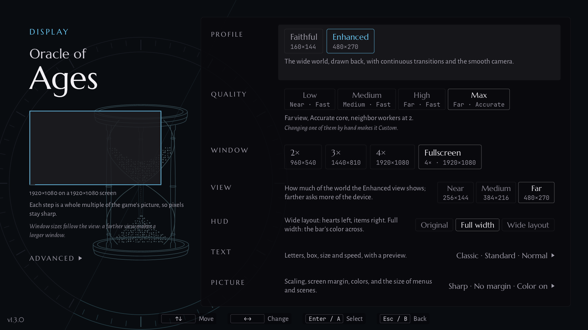

# Playing

The manual of The Oracles Project: what each page of the launcher does, and how the game plays with it. The command line, every key of `settings.txt` and each option in full detail, for route authors and anyone who edits the settings by hand, are in [`REFERENCE.md`](REFERENCE.md).

- [What you need](#what-you-need)
- [Getting started](#getting-started)
- [The home screen](#the-home-screen)
- [Cartridge](#cartridge)
- [Display](#display): [Faithful and Enhanced](#faithful-and-enhanced), [View](#view), [HUD](#hud), [The camera](#the-camera), [Display › Text](#display--text), [Display › Picture](#display--picture), [Unvisited rooms](#unvisited-rooms), [Display › Advanced](#display--advanced)
- [Controls](#controls)
- [Gameplay options](#gameplay-options): [Continuous transitions](#continuous-transitions), [Hold to swim](#hold-to-swim), [Item hotkeys](#item-hotkeys)
- [Cheats](#cheats)
- [RetroAchievements](#retroachievements)
- [Languages](#languages)
- [Mods](#mods)
- [Fan games](#fan-games)
- [In game](#in-game): [the pause menu](#the-pause-menu), [keys](#keys), [savestates](#savestates)
- [Saves](#saves)
- [Portable mode](#portable-mode)
- [Android](#android)
- [Troubleshooting](#troubleshooting)
- [Reporting a problem](#reporting-a-problem)
- [Settings and privacy](#settings-and-privacy)

## What you need

- Your own ROM of Oracle of Ages or Oracle of Seasons, from the US cartridge. The port recognizes the original US ROMs by their SHA-1, which the [README](../README.md) lists, and plays them with every option.
- Any other ROM of an Oracle plays too, in Faithful only: without the wide view and without the gameplay options.
- For Oracles Combined, both games in one, its release's BPS patch in your language and the two European ROMs ([Oracles Combined](#oracles-combined)).
- A `.zip` that holds the ROM works as well as the ROM itself. 7z and RAR archives are not read.
- For the languages, the European ROM of the same game ([Languages](#languages)).
- For a fan game, its BPS patch in the version listed under [Fan games](#fan-games), and the ROM of the Oracle it is built on.

## Getting started

1. Download the file for your system from the [latest release](https://github.com/thibautbus/top/releases/latest):
   - **Windows**: unzip the folder and run `the-oracles-project.exe`. The executable is not signed, so SmartScreen may warn the first time: **More info**, then **Run anyway**.
   - **macOS**: unzip it and move The Oracles Project to Applications. It is not notarized. On macOS 11 to 14, right-click it the first time and choose **Open**. On macOS 15 or later, open it once, then choose **Open Anyway** in **System Settings › Privacy & Security** and confirm.
   - **Linux**: make the AppImage executable and run it. If it does not start, take the `.tar.gz` instead and run `./the-oracles-project` from its folder.
   - **Android**: install the APK, allowing your browser or file manager to install it when Android asks.
2. Open the launcher. The home screen lists Oracle of Ages, Oracle of Seasons and Fan games.
3. Pick a game, open **Cartridge** and choose its ROM with **Choose ROM…**, or drop the ROM's file on the window.
4. Choose **Play** at the bottom of Cartridge, or **Start game** in the game's menu.

The game starts in Enhanced, the wide view, in fullscreen; [Display](#display) changes the view, the window and the quality. Its save is written beside the ROM, under the same name: `Oracle of Ages.sav` for `Oracle of Ages.gbc`, in the format other emulators use.

## The home screen

The home screen has three entries: **Oracle of Ages**, **Oracle of Seasons** and **Fan games**. The chosen entry shows its title, its state and its menu. The state is **Ready** (with the date of the last session), **ROM not found**, or for a fan game whose Oracle's ROM is chosen, **Patch not found**, or **Patch refused** when its patch is there but refused (not a BPS patch, or another fan game's); Oracles Combined says **ROM refused** when a ROM chosen for it is not the European ROM of its game.

A game's menu has **Start game**, **Cartridge**, **Controls**, **Display**, **Mods**, [**Achievements**](#retroachievements), **Cheats** (not for an unrecognized ROM) and **Exit**. Cartridge names the language beside it when it is not English (US), Display the profile the game plays in, and Mods how many mods are on. **Fan games** lists Gifts of Kinomi, Moonrise Regalia, Oracles Combined and Temple of Seasons, each with its state; a fan game picked has the same menu, with Mods and Achievements grayed. A grayed entry says why when it is highlighted.

Move with the arrows, Enter and Escape on the keyboard; with the d-pad, A and B on a controller, where the menu's button and Guide act as Escape; or with the mouse, or by touch. **F11** switches fullscreen on and off. The key hints at the bottom of each page, the pause menu's included, show the keys of the device you used last.

The launcher opens in a 16:9 window of 1280x720 the first time. The window can be resized, and its size is remembered. A window or a screen nearer 4:3 than 16:9, such as a 640x480 handheld or a 1024x768 monitor, takes the 4:3 layout: the three entries become tabs along the top, each page lays its rows in one column, and Controls splits into three tabs, **Buttons**, **Hotkeys** and **In game**.

The home screen's bottom left has a **Settings** button, beside the version (**v1.5.0**), which opens [Settings](#settings-and-privacy). When a newer version is out, the home screen says so after them ("· 1.5.1 available"). Down from **Exit** reaches the notice, then Settings; the notice opens the release page in your browser.

## Cartridge

| Row | Choices | What it does |
| --- | --- | --- |
| **ROM** (a fan game: **Base ROM**) | **Choose ROM…** | The game's ROM, a `.zip` holding it too, or a file dropped on the window. Its status: an original ROM plays every profile, an unrecognized one Faithful only, a refused one says why. |
| **Patch** (fan games) | **Choose patch…** | The fan game's BPS patch, or a `.zip` holding it. |
| **European ROM** (Ages, Seasons) | **Choose…**, then **Change…** and **Remove** | Optional: the European ROM of the same game, which the languages come from. |
| **Language** (Ages, Seasons) | English (US), English (EU), and French, German, Italian and Spanish, each named in its own language | The text the game plays in. English (US) is the cartridge's; the others need the European ROM. |
| **Save** | **Open folder** and **Import save…**; on Android **Export save…** and **Import save…** | The game's save and its date ([Saves](#saves)). |
| **Play** | | Starts the game. |

**Choose ROM…** opens the system's file dialog: on Linux the desktop's, or zenity's where it is installed. Without one, the launcher asks you to drop the file on the window. Dropping a file works everywhere: on a game's Cartridge page it is that game's ROM, or the patch on a fan game's page, and on the home screen the launcher recognizes the game and files the ROM under it.

A ROM, a European ROM or a patch may come as a `.zip`. The zip must hold one ROM (a `.gbc` or `.gb` file) or one patch (a `.bps` file); its other files, such as a readme, are left aside. A zip of several ROMs, an encrypted zip, or a 7z or RAR archive is refused, and the page says why. The save of a zipped ROM goes beside the zip, under its name.

The launcher remembers each game's ROM. A refused ROM shows its reason and is not remembered. Cartridge is on the home screen only: a game takes its ROM, its language and its save when it starts. The exact rules for files and zips are in [`REFERENCE.md`](REFERENCE.md#roms-patches-and-zips).

## Display

| Row | Choices | Default | What it does | Plays in | From the pause |
| --- | --- | --- | --- | --- | --- |
| **Profile** | Faithful, Enhanced | Enhanced | Faithful shows the game's own screen, 160x144. Enhanced shows the wide view, with the rooms around Link. | both | grayed |
| **Quality** | Low, Medium, High, Max; Custom when set by hand | the device's | Sets **View**, **Core** and **Neighbor workers** in one choice: Low is Near on Fast, Medium is Medium on Fast, High is Far on Fast, Max is Far on Accurate with two workers. | Enhanced | grayed |
| **Window** | 2x, 3x, 4x, Fullscreen | Fullscreen | The window's size, a whole multiple of the game's picture so that pixels stay sharp. Grayed where the screen holds one size only, and on Android, which plays fullscreen. | both | at once; smaller windows from the home screen only |
| **View** | Near, Medium, Far | by Quality | How much of the world the wide view shows; farther asks more of the device. | Enhanced | grayed |
| **HUD** | Original, Full width, Wide layout | Full width | The status bar: as the game draws it between two dark bands, its color across the whole width, or laid out with the hearts on the left and the items on the right. | Enhanced | at once |
| **Text** | › | | Opens [Display › Text](#display--text). | | |
| **Picture** | › | | Opens [Display › Picture](#display--picture). | | |
| **Advanced** | › | | Opens [Display › Advanced](#display--advanced). | | |

Display holds for every game the home screen starts, and its choices apply at the next **Play**. The tables say which rows also change from the pause. The sizes Display shows, and its diagram, are those the game will take on the screen the window is on. A window too large for the screen with its title bar is reduced when the game starts, and Display says so.

**Quality** sets **View**, **Core** and **Neighbor workers** at once, for the device. The first opening takes a quality for the device: Max on computers; on Android, High on a device of 8 processor threads and 6 GB of memory or more, Medium otherwise. Changing one of the three rows by hand makes the quality **Custom**, which shows but cannot be picked; picking a quality sets all three again.

After a game in Enhanced that ran slowly, the home screen suggests the quality just lighter, in a notice at the bottom left: "The game ran slowly at High: Medium may play smoother." Under Custom, it suggests a nearer view. Nothing changes by itself: a click on the notice opens Display on that row. The suggestion comes once for a quality, until you change the view, the core or the workers.

**Text** and **Picture** sum up their rows beside them, as "Compact · Wide · Normal" or "Sharp · No margin · Color on", with " · Instant" after Text when the text speed is Instant.

### Faithful and Enhanced

**Faithful** shows the game's own screen, 160x144, exactly as the game draws it.

**Enhanced** shows the game in a wide view. The rooms around Link are drawn beside the one he is in, so that the world reads as one piece, and the camera follows him. The neighboring rooms are computed by the game itself, in a second copy of it that runs in the background: a room not ready yet stays black for a moment, and one that changes while you play (a door that opens) keeps its picture until the new one is ready.

The rooms nearest Link come first; in the drawn-back views, the far corners of the view follow before a room change brings them in, and in Ages' sea the rooms on the other side of the surface, below Link as he swims or above him under water, are ready sooner for a dive or a return to the surface.

Their people and objects stand where the game puts them, and in Ages and Seasons follow the story: when an event changes who is in a room, the room around shows it as the game now would, its old picture staying until the new one is ready. Those that move in place, such as villagers, flowers and fountains, move there too, while enemies keep their pose, and at the Low quality everything there stays still.

A dungeon's large room shows whole, with the rooms beside it that it opens onto, through a door or an open side, as the rooms around Link outdoors, and nothing past the door that leads out of the dungeon; an interior of one room is centered. Coming out of a dungeon, the view stays blank, as the game's screen does, until it opens from the middle, across the whole view. The game's menus, map, cutscenes and file screen show framed in the middle, at the view's scale or larger with **Display › Picture › Menus & scenes**. **F3** switches between the wide view and the game's own screen, framed.

An unrecognized ROM plays in Faithful whatever the profile chosen, and Display says so.

### View

**View** chooses how much of the world Enhanced shows, in the shape of your screen:

| View | 16:9 screen | 4:3 screen | Outdoors |
| --- | --- | --- | --- |
| **Near** | 256x144 | 213x160 | more than a room across |
| **Medium** | 384x216 | 320x240 | two rooms across or more |
| **Far** | 480x270 | 480x360 | three rooms across and two down (nearly three in 4:3) |

Far is the default on computers; on Android, the quality the device starts with chooses (Far at High, Medium at Medium). In Near on a 4:3 screen, which is narrower than a dungeon's large room, the view follows Link inside the room rather than showing it whole. The farther the view, the more work for the device: on a small handheld, Medium may play smoothly where Far does not.

On a screen that Far's usual size fills badly, Far takes a size made for it, with as much of the world as the screen allows. That is 426x320 on a 1280x960 screen (a Retroid Pocket Nova, an Anbernic RG477M, a Retroid Pocket Mini) and 412x360 on 1240x1080 (a Retroid Pocket Mini V2 or Classic, an AYN Thor's bottom screen): a little less than three rooms across, but at a larger scale. On those screens only, **Display › Picture › Far size** chooses that size (Fitted) or Far's usual one (Fixed).

With a **Screen margin**, the size is chosen for the part of the screen the margin leaves: where the size made for the screen no longer fits there at its scale, Far keeps its usual one, and the row goes. So on those screens, changing **Screen margin** changes Far's size, from the next game you start (in the pause the margin itself applies at once), and with it which savestates load: a savestate refused for it says to set the margin back. The view's sizes and their rules are in [`REFERENCE.md`](REFERENCE.md#the-views-sizes).

### HUD

**HUD** draws the game's status bar in one of three ways, in Enhanced:

- **Original**: as the game draws it, 160 pixels wide, between two dark bands;
- **Full width**, the default: across the whole view, the bands beside it taking the bar's own color as the game changes it;
- **Wide layout**: across the whole view, the hearts and the money at the left, the items of B and A at the right, and the item hotkeys' slots just before B. The hearts take one row where the view is wide enough (Medium and Far), the game's two rows in Near, and in Medium on a 4:3 screen while the hotkeys' hotbar shows. In Near on a 4:3 screen the slots do not fit and are not drawn; the hotkeys work all the same.

The bar never covers the world, and the game's menus and cutscenes keep it centered. A change applies at once, from the pause too.
- **Floating**: no bar. The world fills the screen, and the hearts, the rupees and the items float over it in rounded, see-through panels drawn from the game's own pixels: the hearts at the top left, the rupees at the top right, B and A at the bottom left, or the item hotkeys' tiles with them when the hotkeys are on: a diamond like a controller's buttons when a controller was connected as the game started (a handheld's own controls count) or your last item key was on one, or three rows of two keys of the keyboard (Q W, A S, then B and A, with the default keys) when your last item key was on the keyboard or no controller was connected at the start. **Panels**, under HUD while Floating is chosen, colors them: **Bar color**, the bar's own color with an edge, or **Neutral**, a light gray. The panels keep clear of the touch controls on Android, and the Display › Text preview shows them over the whole world.
- **Floating**: no bar. The world fills the screen, and the hearts, the rupees and the items float over it in rounded, see-through panels drawn from the game's own pixels: the hearts at the top left, the rupees at the top right, B and A at the bottom left, or the item hotkeys' tiles with them when the hotkeys are on: a diamond like a controller's buttons when a controller was connected as the game started (a handheld's own controls count) or your last item key was on one, or three rows of two keys of the keyboard (Q W, A S, then B and A, with the default keys) when your last item key was on the keyboard or no controller was connected at the start. **Panels**, under HUD while Floating is chosen, colors them: **Bar color**, the bar's own color with an edge, or **Neutral**, a light gray. In the Near view every panel, the hotkeys' tiles included, is drawn at half the game's scale, crisp under any filter, so that they all fit; on a screen too small to show Near at twice its size, B and A stand there alone. With Android's touch controls shown, B and A stand alone under the hearts and the rupees left of the pause button, clear of the controls. The season's or the era's sign the game shows at the top left on entering an area (Seasons' season, Ages' present or past) stands in front of the panels, as it stands below the bar in the game. The Display › Text preview shows the panels over the whole world, with B and A alone.

### The camera

In Enhanced the camera follows Link at his own speed, steady on stairs as on flat ground, and settles as soon as he stops, his sprite steady on the screen. When the game puts Link back somewhere else, after a fall or a whirlpool, the camera finds him again quickly; when it moves him while the world is not shown, during a menu, a scene on the game's own screen or a fade to white or black, the camera is already on him when the world comes back, without gliding there. It does not run ahead into a neighboring room that is still being prepared. **Display › Advanced › Camera** chooses how finely it moves. **Smooth** moves it by fractions of a pixel at your screen's resolution, so that diagonal walks, swims across the sea floor and stairs glide, in a dungeon's large rooms as outdoors. **Pixel** keeps the game's whole pixels.

Smooth is the default on computers. On Android, it is the default where the game is shown at three times its size or more, as in every view on a 1080-line screen, and Pixel is the default below that. A choice applies at once, from the pause too. Where the game is shown at less than twice its size, the row says that it has no effect there.

### Display › Text

| Row | Choices | Default | What it does | Plays in | From the pause |
| --- | --- | --- | --- | --- | --- |
| **Text** | Classic, Compact | Classic | Classic: the game's fixed-width letters. Compact: each letter takes its own width, so more words fit on a line and a dialogue takes fewer boxes. A savestate taken with Compact needs Compact. | Enhanced; Ages, Seasons and the fan games | grayed |
| **Text box** | Standard, Wide | Standard | Standard: the game's box. Wide: a longer box with longer lines, fewer boxes still with Compact. A savestate taken with Wide needs Wide. | Enhanced; Ages, Seasons and the fan games | grayed |
| **Text size** | Normal, Large, Very large | Normal | Draws the text box larger where the view has room for it, the next size down where it has not, for reading from a distance or on a small screen. | Enhanced; Ages, Seasons and the fan games | at once |
| **Text speed** | Classic, Instant | Classic | Classic: letter by letter, at the speed chosen on the game's file screen. Instant: each line appears whole; A still turns the page. | both; not on an unrecognized ROM | when the game resumes |

The page shows a preview of the view the game will play in: the status bar at the top, and the text box at the bottom at the size it will take there, in the font of your ROM (bars stand in for the text without a ROM). Where the view has no room for the size chosen, the preview says which size it falls back to.

**Text** and **Text box** are laid out when the game starts, so they change from the home screen only. **Text speed** changes the game's pace rather than its picture, so it plays in Faithful too. With Instant, A still turns the page: if you are used to pressing A twice, the second press turns the next page. A few texts the game shows slowly on purpose still begin letter by letter.

Each option is detailed in [`REFERENCE.md`](REFERENCE.md#the-compact-text): the compact text, the wide text box, the text size and the text speed.

### Display › Picture

| Row | Choices | Default | What it does | Plays in | From the pause |
| --- | --- | --- | --- | --- | --- |
| **Scaling** | Sharp, Fill | Sharp | Sharp: the largest whole scale, every pixel exact. Fill: the whole screen in the game's proportions, pixels slightly softer. Fullscreen only: a window keeps its whole steps. | both | at once |
| **Filter** | Off, Scanlines, CRT, LCD, Smooth, xBR, HQ2x, OmniScale | Off | The game's picture drawn through a filter: Scanlines draws dark lines between the rows, as on an old TV; CRT the glow and lines of an old TV; LCD the grid of a Game Boy screen; Smooth softens the pixels; xBR rounds diagonals and curves; HQ2x smooths edges and keeps the pixel look; OmniScale smooths edges at any size. ←→ steps through them. | both | at once |
| **Screen margin** | Off, Auto, Small, Large | Off | Keeps the picture clear of screen edges a device hides. Auto follows what the system reports; Small and Large keep a fixed margin at the top and the bottom. | both | at once |
| **Color correction** | Off, On | On | On: colors as the Game Boy Color's screen showed them. Off: the raw palette. Also F2 in game. | both | at once |
| **Far size** | Fitted, Fixed | Fitted | Fitted: Far takes a size made for this screen. Fixed: Far's usual size. Shown only on a screen where the two differ, such as 1280x960 or 1240x1080. | Enhanced | grayed |
| **Menus & scenes** | View, Large | Large on Android, View elsewhere | Large: the game's menus, map, cutscenes and file screen alone, at their own largest scale, easier to read on a small screen. View: at the view's scale. | Enhanced | at once |
| **Unvisited rooms** | Shown, Dungeons, Hidden | Shown | Dungeons keeps the rooms Link has never entered dark around him in a dungeon only, the rooms outside always shown. Hidden keeps them dark everywhere, as the game's map does. | Enhanced | when the game resumes |

**Fill** applies in fullscreen only, which Android always is; in a window, the game keeps its whole steps. While **Filter** has the focus, a preview shows the choice: from the home screen, the last picture of the last game you played (before any game, a sample picture), from the pause, your game as it resumes. The filter touches the game's picture only, never the launcher's menus or the larger text box of **Text size**. Smooth works everywhere; the other filters need a graphics chip that runs them (Vulkan, or Metal on a Mac): where it cannot, they are grayed, "Not available on this device.". They also need room to draw within each pixel of the game: under twice the game's size (three times for CRT and LCD) they are grayed, "Needs a larger picture: try a nearer view or Faithful.". A filter you chose stays chosen when the picture becomes too small for it, as when you switch to a farther view: the game is drawn without it until the picture is large enough again. With the Smooth camera, Link still glides under every filter. **Screen margin** is for a screen whose edges hide part of the picture ([Troubleshooting](#troubleshooting)). **Far size** shows only on a screen where Fitted and Fixed differ, its note giving both sizes.

### Unvisited rooms

The wide view shows the rooms around Link, rooms he may never have seen. With **Display › Picture › Unvisited rooms** on **Hidden**, a room around him that he has never entered stays dark, its people and objects with it, as the game's own map leaves blank the squares he has not visited. Where a dark room meets a room you can see, a glimpse of it shows along their border, the room as it is, people and enemies included, and fades into the dark in a soft, wavy edge; between two dark rooms the dark stays whole. The Low quality keeps a straight edge. The view reads the same record as the map, which the save keeps: an old save shows at once the rooms already visited, and a new game starts with none.

The room Link is in always shows, and a room he enters for the first time fades in. A room visited in the other era of Ages stays dark until he enters it in this one. In a dungeon, the rooms beside his that he has never entered stay dark too, so that the view gives away no more of the dungeon than its map. With **Dungeons**, only the dungeons keep their rooms never entered dark: outside them, every room around Link shows, as with **Shown**. Hidden and Dungeons change only the picture, never the game or its savestates. From the pause, a change applies when the game resumes.

### Display › Advanced

| Row | Choices | Default | What it does | Plays in | From the pause |
| --- | --- | --- | --- | --- | --- |
| **Core** | Accurate (SameBoy), Fast (mGBA) | Fast on Android, Accurate elsewhere | The emulator the game runs on. Accurate: the reference. Fast: lighter, for small devices. A savestate loads only on the core it was taken on. | both | grayed |
| **Continuous transitions** | Off, On | On | Rooms scroll into one another instead of stopping at each edge, Link walking and swimming through. A savestate taken with it on needs it on. | Enhanced | grayed |
| **Vsync** | Auto, On, Off | Auto | Shows each frame in step with the display, whole instead of torn across the screen. Auto: on at 60 Hz and at 100 Hz or more, such as 120 or 144 Hz; off on Android, which composes the frames itself. | both | when the game resumes |
| **Neighbor workers** | Auto, 1, 2 | Auto | The background workers that prepare the rooms around Link, each on a processor core of its own. Two fill the view faster after a warp or a load. Auto takes two on a device of four processor threads or more, and says which. | Enhanced | grayed |
| **Camera** | Pixel, Smooth | the platform's | Smooth: the camera moves by fractions of a pixel at the screen's resolution, so diagonal walks and stairs glide. Pixel: whole pixels, as the game does. Smooth is the default on computers; on Android, where the game is shown at three times its size or more. | Enhanced | at once |

**Core** decides which emulator runs the game. Accurate (SameBoy) is the reference; Fast (mGBA) is lighter, for small devices. A game's save is the same file on both cores, but a savestate loads only on the core it was taken on. **Neighbor workers** on Auto says how many it takes ("Auto · 2"). With **Vsync** on, the launcher checks that the display really waits for each frame, and paces the game itself if it does not. On a display faster than 60 Hz it always paces the game itself, and turns vsync off should waiting for the display slow the game down; on a display slower than the game, such as a television at 50 Hz, vsync stays off, on On too.

## Controls

| Tab | Row | Keyboard | Gamepad | What it does |
| --- | --- | --- | --- | --- |
| Buttons | Right, Left, Up, Down | arrows | D-pad, left stick | Link's moves. On a controller the d-pad and the left stick always move. |
| Buttons | A, B, Select, Start | X, Z, Backspace, Enter | A, B, Back, Start | The game's buttons. |
| Hotkeys | Slot 1 to Slot 4 | A, S, Q, W | X, Y, LB, RB | Each key acts on the item in its slot ([Item hotkeys](#item-hotkeys)). |
| Hotkeys | Bind to B, Bind to A | Left Shift, Left Ctrl | | Held with a slot's key, puts the item of B or of A in that slot. |
| In game | Menu | Esc | L3 | Opens the pause menu, as the controller's Guide button does. The controller's button may be any button the game leaves free, or a trigger. |
| In game | F2, F3, F5, F7, F11 | | | Color correction, wide world or frame, save state, load state, fullscreen. These keys do not change. |

| Row | Choices | Default | What it does | Plays in | From the pause |
| --- | --- | --- | --- | --- | --- |
| **Item hotkeys** (Hotkeys) | Off, On | Off | The item hotkeys of the game shown. | both; Ages and Seasons, original ROMs, and Oracles Combined | when the game resumes |
| **Swimming** (In game) | Tap, Hold | Tap | Hold: a direction held swims at full speed, instead of tapping A with the flippers or the direction with the mermaid suit. | both; Ages and Seasons, original ROMs, and the fan games but Moonrise Regalia | when the game resumes |
| **Touch vibration** (In game; Android only) | On, Off | On | A short vibration with each press of the touch controls, while Android's touch feedback is on. Off: no vibration, whatever Android's setting. | both | at once |
| **Reset to defaults** (Buttons) | | | Puts back the default keys and buttons, the hotkeys' and the menu's included, turns **Touch vibration** back on, and brings back the reminder of the menu's key and the pause menu's line on the item hotkeys; the items in the slots, **Item hotkeys** and **Swimming** stay as they are. | | |

The keys and buttons hold for every game; **Item hotkeys** and the items in the slots belong to the game shown. Each change is written at once. Choose a cell and press the key or the button to bind; Escape cancels, as do the menu's button and Guide on a controller. A key already bound elsewhere on the same device moves to the new cell, and the other cell stays empty. From the pause, keys and buttons change at once.

The menu's controller button is L3, the left stick's click, by default. Its cell takes only a button that the game's buttons and the item hotkeys leave free, or a trigger: with the default buttons, LT, RT, L3 or R3. The other cells never take the menu's button: to give it to another action, change Menu first. On a handheld without sticks, a trigger is often the only free input.

The fixed keys, Escape and F2 to F11, show once you have pressed a key, and on a computer until you use a controller. On Android, F11 never shows, and Back stands beside Menu ("Menu · also Back" in the 4:3 layout).

Each game you start reminds you how to open the menu, in a short notice under the status bar: it starts only in play, a moment after the status bar shows, never over a title, a menu, a dialogue or a cutscene. It says "L3 opens the menu" with a controller, naming the menu's button ("Guide opens the menu" when none is set), "Esc opens the menu" with the keyboard, "The pause button opens the menu" by touch, and "L3 or Back opens the menu" with a controller on Android. It names the device you used last and fades after a few seconds. Once you open the menu with its key it stops; otherwise it comes back for ten games at most.

With **Item hotkeys** Off, **Controls › Hotkeys** grays the slots and says under them what On does: "Off: turn it on to use an item with one key, without opening the inventory." A game without them, a fan game other than Oracles Combined, says "Not available for this game." under the row, which stays Off; Moonrise Regalia says the same under **Swimming**, which stays live: it is one setting for every game.

## Gameplay options

These options change how Link moves and what the keys do. Each says below where it plays: the fan games have the continuous transitions, Gifts of Kinomi, Temple of Seasons and Oracles Combined hold to swim too, and Oracles Combined has the item hotkeys.

### Continuous transitions

In the wide view, the game's own scroll from one room to the next no longer shows: without this option, Link stands frozen while it runs. With **Display › Advanced › Continuous transitions** on (the default), he keeps walking through the scroll, his walk animated, and he keeps swimming through it at his own speed.

He moves through the scroll as the keys say, his sprite with him from its first frame, while the game is still preparing the next room, with either camera. A direction held walks him on at the game's own speed; a diagonal held carries him across too, onto ground he can walk on, and a wall holds him as the game would. With his shield up, running on Pegasus seeds or with an item in use (a charged sword), the scroll is the game's own, and where it would leave him inside a wall just past the edge, he ends it where the game itself puts him.

The next room starts only as he crosses the line between the two, so a tap at an edge takes him toward it and leaves him in his room. When you let go, he stops where he is and stands; turned back, he walks back, and across the line into the room he left.

Swimming, at the surface or on Ages' sea floor, he swims through the scroll as anywhere else: the pad and his strokes speed him up and turn him, and let go he glides and slows down as in the middle of a room, so a tap at an edge glides him no further than it would there, the next room starting only if his glide takes him across the line; turned back, he swims back across it.

At a corner, a diagonal takes him on into the room across as on foot, at the surface and on Ages' sea floor alike. Swimming up into a room, he never ends the scroll in its last rows at the bottom, where the game would take him out of the water: a glide too slow to leave them is carried on just past them, and turned back there he swims back into the room he left. A current still carries him over as the game has it.

On an animal, in the cart, in a side view, in a dungeon's large rooms, or when the game itself walks him into the next room during a scene, rooms change as the game has them, so that the scene goes on from where the game puts him.

At the corner where four rooms meet, a diagonal takes him on into the room across at his own pace, the scroll to it following the first at once, his sprite whole and steady all the way, past the edge of the game's own screen too, where the game draws none of him. He slows across instead:

- where the game might lead that scroll elsewhere (the Lost Woods, the edges of the map);
- where someone or something there may take over as he arrives (a scene, a character who stops him);
- where the room across reworks its own ground once it is drawn (a few rooms, a Gasha spot with something planted among them).

A whirlpool or a hole just past an edge brings him back where the game would, not right next to it.

The option plays in Enhanced only. The three fan games made on one Oracle have it, the diagonal included, but there a tap at a room's edge takes Link through the whole scroll by himself, and a whirlpool or a hole just past an edge brings him back where the scroll left him. A savestate taken with the option on loads only with it on. Its exact rules, for route authors, are in [`REFERENCE.md`](REFERENCE.md#continuous-transitions).

### Hold to swim

Swimming, Link speeds up by strokes, and the game starts a stroke only on a new press: of A with the flippers, of the direction with Ages' mermaid suit. With **Controls › Swimming** on **Hold**, holding the direction swims as fast as the best tapping does, and so does holding A with the flippers. With nothing held, Link slows down and stops, as the game has him; tapping still swims too.

Hold plays in Faithful and Enhanced, in Ages and Seasons on their original ROMs, and in Gifts of Kinomi, Temple of Seasons and Oracles Combined; Moonrise Regalia does not have it yet. From the pause, a change applies when the game resumes. The details are in [`REFERENCE.md`](REFERENCE.md#the-swims-hold).

### Item hotkeys

Four keys act on four slots, each holding an item: A, S, Q and W on the keyboard, X, Y, LB and RB on a controller. To fill a slot, hold **Left Shift** for the item of B, or **Left Ctrl** for the item of A, and press the slot's key. With the inventory open on the items, a slot's key takes the item under the cursor.

With **Controls › Item hotkeys** on, a slot's key is one more item button: its item goes onto a button for as long as you hold the key, and that button's own item comes back a moment after. When Link holds a bomb or something he lifted over his head, any slot's key throws it, as B does. Another mode, which equips the item instead, is only in the command line and the settings ([`REFERENCE.md`](REFERENCE.md#item-hotkeys)).

Taking an item into a slot, and equipping one in that other mode, plays the game's own equip sound, as the inventory does. Using an item through its key makes no such sound.

In Enhanced, a hotbar beside the status bar shows the four slots: each item's icon, from the start of play, its key and the button it is on. In Medium and Far each slot looks like the game's own B and A, the key's letter then the item between brackets, drawn where B and A draw it with its count or level as they show it (bombs and seeds counted, a sword's "L-3") ("LB" shows a big L with a small B under it, which the button's badge replaces while the item is on B or A); in Near it is more compact. An empty slot has dotted brackets or frame, an item Link does not have a faded icon; a slot blinks while it waits, and turns red when the game refuses. The hotbar comes and goes with the status bar, and never shows on the game's own screen that F3 switches to. In Near on a 4:3 screen there is no room for it, but the keys work all the same, and **Controls › Hotkeys** shows the slots' items.

The keys hold for every game, and each game keeps its own slots, Oracles Combined one set for both its games. Loading a savestate cancels an exchange under way, and the hotkeys go on working after it. Item hotkeys play in Faithful and Enhanced, in Ages and Seasons on their original ROMs and in [Oracles Combined](#oracles-combined); the other fan games do not have them yet. From the pause, a change applies when the game resumes.

## Cheats

| Row | Choices | What it does |
| --- | --- | --- |
| **No damage** | Off, On | Enemies, spikes and falls no longer cost hearts. Link is still knocked back. |
| **Ammo never runs out** | Off, On | Seeds, bombs and Bombchus are not used up. |
| **Rupees never run out** | Off, On | Buying costs nothing. Mods still charge. (A fan game, which has no mods, says the first sentence alone.) |

The Cheats page is in the menu of Ages, Seasons and the fan games, after Achievements; each game has its own cheats. Under its title it says: "Cheats play with your usual save: what you keep stays in it.". Left, right and Enter turn the highlighted cheat off and on; each change is kept at once, for the next Play.

- **No damage**: a hit still knocks Link back, with its sound and its flash, but costs no heart, so a hit never ends the game. A fall into a hole, water or lava sends him back at no cost. The few moments where the story itself takes hearts still do.
- **Ammo never runs out**: a seed, a bomb or a Bombchu used is not taken from its count. With none left there is still none.
- **Rupees never run out**: a price is free, as long as the wallet holds it, which the game checks first. A mod's prices still apply.

The cheats change nothing else in the game: what they leave, such as rupees kept, items bought or ammunition kept, is in your usual save. They play in Faithful and Enhanced, in Ages and Seasons on their original ROMs and in the fan games, in both halves of Oracles Combined. In Temple of Seasons, **Ammo never runs out** keeps its seeds as it keeps its bombs, and **Rupees never run out** makes every purchase free. From the pause, **Cheats** changes the cheats of the game running, from when it resumes. A cheat turned on suspends [achievements](#retroachievements) until the game starts again. In Faithful, the first cheat turned on from the pause makes the game a little heavier to run until it ends, which a small device may feel.

## RetroAchievements

Ages and Seasons on their original ROMs have achievements from [RetroAchievements](https://retroachievements.org): written by players and unlocked as you play, in Faithful and Enhanced. They need an account on retroachievements.org, made on its site, and stay off until you log in. A fan game has none, and neither has a ROM the launcher does not recognize as an original: **Achievements** is grayed for them, "Not available for this game" for a fan game, and "Needs an original ROM" for such a ROM or while Ages or Seasons has none.

**Achievements**, on a game's menu above **Cheats**, opens their page:

| Row | Choices | What it does |
| --- | --- | --- |
| **Account** | Log in…, Log out | Your account, one for every game. |
| **RetroAchievements** | Off, On | On unlocks achievements as you play. Off, the default, sends nothing. On without an account opens the login. |
| **Privacy** | Player's guide | Opens this section in your browser. |
| **Unlock sound** | On, Off | A short sound with each unlock. The toast shows either way. |

### Logging in

**Log in…** asks for your **User name** and **Password**, as on retroachievements.org. Once you are in, the account is kept and **RetroAchievements** turns On. A line under the fields says when the server refuses them ("Wrong user name or password.") or cannot be reached. Should the server refuse the saved login later, the page says so ("retroachievements.org refused the saved login: log in again.").

Type with a keyboard, with Android's keyboard for a touch, or with a controller on the launcher's own keyboard, on a computer too. To take a password from a password manager, **Ctrl+V** (**Cmd+V** on a Mac), **Shift+Insert**, a keyboard's Paste key or the launcher's keyboard's **Paste** paste the clipboard into the field highlighted, without the spaces or the line break around it; on Android, the system keyboard's own paste works too. A text of several lines, or one longer than the field holds, is not pasted at all, and the line under the fields says so.

The eye at the right end of the password shows it in letters until the login closes or the window goes away: **X** on a controller, Tab to the eye then Enter or Space on a keyboard, or a click or a touch. On Android, the window stays out of screenshots and of the recent applications' thumbnail while the login is open.

### Seeing your achievements

Logged in and On, the page lists the achievements of the game chosen under its rows: those you unlocked, then those remaining, in the order of the game's set. The arrows and the d-pad go through them, the list following the highlight; the wheel or a drag scroll the list, and a click or a tap highlights the achievement under it without moving the list. The server gives this list no dates, so it says "Unlocked" alone; the pause menu gives the date.

In a game, toasts at the top left of the picture say your progress as the game starts, each unlock with its badge, and anything that stops the achievements. **Achievements** in the pause menu lists the game's achievements with your points: unlocked, with their dates, then in progress, then locked.

A row cuts its description after one line, so each achievement has its detail, on the page and in the pause menu alike: its badge in large, in color once unlocked, its title, points, the share of players who have it in casual mode ("12.4% of players") when the server gives one, its **Missable**, **Progression** or **Win** tag when it has one, its whole description and its state. In the 16:9 layout the left column shows it for the achievement highlighted, with no key to press, and the game's name comes back on a row of settings. In the 4:3 layout, Android's large menus and a pause in a window too small for that column, **Enter**, **A**, a click or a tap on an achievement opens a panel over the list: up and down go to the next one without closing it, and **Esc**, **B** or a tap outside closes it on the same achievement. Dragging the list never opens a row. The page's detail says "Unlocked" alone, the pause menu's "Unlocked 7 Nov 2026". Reading it asks nothing of the server.

### Casual mode

The launcher plays RetroAchievements in casual mode alone: it has no hardcore mode and no leaderboards, and every launcher feature stays, savestates included.

- **A savestate loaded** starts the achievements' progress again: an achievement whose conditions already hold in it waits for them to fail once before it can unlock.
- **A cheat** suspends them until the game starts again, whether it was on from the start or turned on from the pause. The Cheats page warns you, a toast tells you, and the pause's list says "Suspended for this session". To have them back, turn the cheat off and start the game again.
- **A mod** plays along with them until it first changes the game: an item given or taken, rupees charged, a flag set. They are then suspended until the game starts again ("Achievements are paused until the game starts again: a mod changed the game.").

### Sessions and playing offline

A session counts on the server when you start Ages or Seasons with **RetroAchievements** On and an account logged in, and lasts as long as the game. Opening the **Achievements** page is never a session: it reads the game's list and your unlocks, and sends no unlock and no sign of playing. A route replayed or recorded has no achievements.

- **No connection as the game starts**: a toast says "RetroAchievements unreachable: achievements are off for this game.". The game plays on, without achievements until it next starts.
- **The connection lost during a game**: unlocks still show, and a toast says "Offline: unlocks will be sent later". The launcher keeps trying while the game runs, and keeps each unlock until the server acknowledges it. What is left goes the next time you start Ages or Seasons with that account, with the time since you earned it. The launcher keeps the latest 256.
- **On the page**: the **Account** row says how many are waiting ("2 unlocks waiting to be sent"), and the list, which comes from the server, shows them locked until they are sent. Opening the page does not send them.
- **The page without a connection**: no list is kept for offline, so it says "retroachievements.org cannot be reached: this game's achievements show when it can.". Open the page again once you are connected. On Linux, the requests go through the system's libcurl, as the update check does; without it, the server cannot be reached.

### What is sent and what is kept

Nothing is sent while **RetroAchievements** is Off, before you log in, or for a fan game. Otherwise the launcher talks to retroachievements.org over HTTPS:

- **At login**: your user name and your password, once. The password is never written anywhere; the launcher keeps the token the server answers.
- **On the page**: your user name, your token and which game it is (the MD5 hash of your ROM), to read the game's achievements and your unlocks. It also downloads the badges' images of that game.
- **While you play**: your user name and your token, the game (the same hash), the achievements you unlock and their badges' images, and, about every two minutes while the game runs, a short line the game's set makes up to say what you are doing in it.
- **Each request** carries a User-Agent naming the application, its version, the platform (Windows, macOS, Linux or Android), the emulator core during a game and the version of rcheevos, and no more about your machine.

What retroachievements.org keeps is up to its own privacy policy.

The launcher keeps these beside `settings.txt`: in `%APPDATA%\the-oracles-project\` on Windows, `~/.local/share/the-oracles-project/` on Linux, `~/Library/Application Support/the-oracles-project/` on macOS, in the application's private storage on Android, and in `user-data` in [portable mode](#portable-mode):

- `achievements.txt`: your user name and your token, never your password. On Linux, macOS and Android, only your own user can read it. The token logs in as you, so never share this file.
- `achievements-pending.txt`: the unlocks waiting, each with your user name, the game's hash, the achievement and when you earned it.
- `achievement-badges`: a folder of the badges' images.

Portable mode does not copy them: each folder has its own account, so log in again after turning it on or off. Unlocks waiting stay in the folder they were earned in.

**Logging out.** **Log out** on the **Account** row forgets the account at once: it deletes `achievements.txt`, which you can also do yourself with the launcher closed, and asks nothing of the server. **RetroAchievements** stays as it was, and nothing is sent without an account. The unlocks waiting stay until that account next plays, and the badges stay too.

## Languages

Ages and Seasons play in French, German, Italian or Spanish, or in the European edition's English, from your own European ROM of the same game. Choose that ROM in **Cartridge › European ROM**, then the language in **Cartridge › Language**. The home screen names the language beside Cartridge.
**Japanese** is the Japanese edition's own text, in its own font, in Faithful and Enhanced. The Goron fortune teller of Ages, added by the US edition, speaks our own Japanese (unofficial). The compact text is not available in Japanese: **Display › Text › Text** stays on Classic, Compact grayed, and comes back to your choice in the other languages; the wide text box shows the game's own lines. The title screen and its Japanese logo, the file select and its screens, the save menu, the game over screen, the secrets' screens and the dungeons' names are the official Japanese edition's too (Nintendo, Capcom, Flagship). The name entry is the Japanese edition's, for Link's name and the child's: kana in hiragana, or in katakana with **Select** or the **カナ** and **かな** buttons below the grid, the small kana, ー and the space; ゛ and ゜ go on the character under the cursor, or on the one before it. A name typed in Latin letters in another language shows in capitals, the Japanese font having no lower-case Latin letters, and the save keeps it as typed; a name typed all in lower case shows as hiragana, since nothing tells it from a kana name. A name typed in kana shows badly if the game goes back to English or another European language, whose fonts have no kana. Secrets are the Japanese edition's: written in kana and digits, typed on a kana grid, and the same as the Japanese edition's, which accepts them. To exchange secrets between Ages and Seasons, play both games in the same language: a secret given in Japanese is refused by a game in English, and the other way round.
**Polish** is Kaxus's fan translation, credited under the language while it is chosen ("Polish fan translation by Kaxus, from your Polish ROM or patch."). It plays in Faithful and Enhanced, with the compact text and the wide box too. The title screen, with Kaxus's banner, the file select and its screens, the save menu and the dungeons' names come from his translation too; the screens it leaves in English, such as the game over screen, stay so. The port ships neither his patch nor its ROM: you give them, and the texts are taken from them on your device.

The texts are taken from your European ROM once, into a pack on your device: nothing of the European game is shipped. Every text is translated, and so are the screens that carry text, such as the file screens, the save menu and the game over screen, as the European game draws them; the title screen and the credits stay as the US game has them. Where the official translation is wrong, the port corrects it, and a few lines of Ages in French are the port's own. **English (EU)** is the European edition's own revision of the English text.

A savestate taken in a language loads only in it. The fan games play in English from the home screen for now: they share many texts with their Oracle, but their own dialogues are not translated yet, so they have no Language row. The details are in [`REFERENCE.md`](REFERENCE.md#languages-in-detail).

## Mods

| Row | Choices | What it does |
| --- | --- | --- |
| **Folder** | **Open folder** | Opens the mods folder, making it first if need be. |
| **Mods** | Off, On for each mod | Each mod found in the folder, with what it adds, or why it is refused. Eight at most play together. |
| **Save** (Android) | **Export save with mods…** | A copy of the save the game with mods plays on, wherever you choose. |
| **Play** | | Starts the game with the mods switched on, on a save of its own. |

**Mods**, in the menu of Ages and of Seasons, lists the mods that add houses, characters and minigames to the game ([`MODDING.md`](MODDING.md)). Beside it, the menu says how many are on. A fan game's menu grays it: "Not available for this game".

The mods live in the **mods folder**, beside `settings.txt`:

- Linux: `~/.local/share/the-oracles-project/mods/`
- macOS: `~/Library/Application Support/the-oracles-project/mods/`
- Windows: `%APPDATA%\the-oracles-project\mods\`
- In the portable mode, on Windows and Linux: `user-data/mods/`, beside the executable ([Portable mode](#portable-mode))
- Android: `Android/data/org.theoraclesproject/files/mods/`, on the shared storage, reachable over USB ([Android](#android))

Each mod is a folder of its own in it, named with a–z, 0–9, `-` and `_`, with a `main.lua` inside. **Open folder**, at the top of the page, makes the folder if need be and opens it in the system's file manager. The page reads the folder again each time it opens.

The page lists each mod found, in the order of their names, which is the order they play in: a switch, its name, the games it adds houses to ("Houses in Ages and Seasons"), and its description, or why it is refused ("Refused: " and the reason). A refused mod stays off. Left and right, Enter or a click switch the highlighted mod, and the choice is kept at once, for each game.

**Play**, at the bottom of the page, starts the game with the mods that are on, on a save of its own: `NAME.mods.sav` beside the ROM. It is copied from the game's usual save the first time, and again after **Import save…** ([Saves](#saves)); a game with mods never writes the usual save. **Start game**, in the game's menu, plays without mods, on the usual save. Play is grayed without a ROM ("Choose a ROM in Cartridge first") and on a ROM that is not the original US one ("Needs an original ROM").

On Android, the **Save** row above Play has **Export save with mods…**: Android's document picker makes a copy of `NAME.mods.sav` wherever you choose (Downloads, an SD card), as **Export save…** does for the usual save, to keep it or play it elsewhere; the mods' data in `NAME.mods.store` stays where it is. The row says "Save with mods exported." once the copy is written. It is grayed until the game with mods has a save of its own: "No save with mods yet: Play with a mod on makes one.". On a computer, **Open folder** in Cartridge shows the file beside the ROM.

To try the two examples, [`mods/claw-game`](../mods/claw-game/) and [`mods/fortune-teller`](../mods/fortune-teller/): the release does not include them, so download the repository from GitHub (**Code › Download ZIP**) and copy both folders, as they are, into the mods folder. Open Ages' Mods page, switch both on, and choose Play. The claw game's house is on the big island in the south of Lynna City, by the bridge, and the fortune teller's on the island east of the red house. The fortune teller counts Link's visits, which it keeps with the save in `NAME.mods.store`.

## Fan games

The Fan games entry lists four games, each with its state:

- Gifts of Kinomi 1.1.2, built on Oracle of Ages;
- Moonrise Regalia 1.0.6, built on Oracle of Ages;
- Oracles Combined 1.5, both Oracles in one, built on their European ROMs ([below](#oracles-combined));
- Temple of Seasons 1.073, built on Oracle of Seasons.

A fan game comes as a BPS patch: you keep the original ROM it is built on, and the patch. Picked, a fan game has the menu of a game, and Escape or B goes back to the list.

Its Cartridge page asks for both files. **Base ROM** is the ROM of its Oracle, the same one the Oracle's own page shows: chosen once, it serves the Oracle and every fan game built on it. **Patch** is the game's `.bps` file, or a `.zip` of it (**Choose patch…**). Before one is chosen, the page names the patch the game expects ("No patch: the BPS patch of Moonrise Regalia 1.0.6 is expected"). Below them, the page says whether the two make the game: recognized, unrecognized (Faithful only), refused with the reason, or "The game needs both files.".

The launcher refuses the patch of another of these fan games, and says which game it is for ("Refused: the patch of Moonrise Regalia, not of Gifts of Kinomi."); the patch chosen before stays. A patch dropped on a fan game's page becomes its patch; dropped elsewhere, it goes to the fan game it makes. The patch is applied in memory each time the game starts, and the patched game is never written. The save goes beside the patch, under its name (`Moonrise Regalia 1.0.6.sav`), not beside the base ROM, whose save is the Oracle's; **Open folder** opens the patch's folder.

Gifts of Kinomi, Moonrise Regalia and Temple of Seasons play in Faithful and Enhanced, in every view, with continuous transitions and every row of Display › Text. They have the cheats, and Gifts of Kinomi and Temple of Seasons hold to swim. From the home screen they do not have the item hotkeys, the languages or the mods yet.

### Oracles Combined

Oracles Combined, by soaresden, joins Ages and Seasons in one game, with one save and a way from one to the other. It continues Crossworld, by vinheim3. It comes as a BPS patch, one for each language (English, French, German, Spanish and Italian), made for the two European ROMs joined, Ages' first: the port joins them and applies the patch in memory at each start, as it does for the other fan games. It recognizes the five patches of release 1.5, from the `.zip` of its GitHub release: take the `.bps` of your language out of it, since a zip of several patches is refused.

| Patch of release 1.5 | SHA-1 |
| --- | --- |
| English | `15029267980b902b15f348b89c5f9142f4684051` |
| French | `6a5acc359ec80dbabc5976978b0afd8414610e9c` |
| German | `9a790e0d11ccc3f2c28d255d77f1d6f0f8604718` |
| Spanish | `78b1c38906be09e8c6bb3fad3cbc8dfa17e7e617` |
| Italian | `86b99d43ffc60d6d67d126f662b2066f5d5b190b` |

Its Cartridge page asks for:

- **Ages ROM (EU)** and **Seasons ROM (EU)**, the European ROMs of Ages and Seasons, the same ones their own pages show for the languages: chosen once, they serve both. A row says "Recognized" once its ROM is there, which is then changed on its Oracle's page ("Set in Oracle of Ages's Cartridge"); else it says the ROM is missing ("Not chosen yet: Oracle of Seasons's European ROM is used") or not its game's ("Not the European ROM of Oracle of Seasons"), and its **Choose…** picks one. **Choose…**, or a file dropped on the page, takes either European ROM and files it under its game; any other file is refused, "Refused: Oracles Combined is made of the European ROMs of Ages and Seasons".
- **Patch**, the `.bps` of your language.

Below them, the page names the game the two make and its language, "Patched image recognized: Oracles Combined v1.5 · English", or says what is missing ("The game needs both European ROMs and the patch.") or that the patch is made for other ROMs ("Refused: this patch is not made for the European ROMs of Ages and Seasons."). Under it, "The language comes with the patch: choose another patch to change it." ("The language comes with the patch." in the 4:3 layout). Its save goes beside the patch, under its name, 32 KiB, the four banks of its cartridge. **Import save…** takes a save of Oracles Combined from another emulator, as it is: 32 KiB, with a game file of Ages or of Seasons whose checksum holds.

It plays in Faithful and in Enhanced, in both games it joins: from the Ages it starts in, through Vasu's door to Seasons and back, and from a file of Seasons chosen on its file screen. What works there, as in Ages and Seasons:

- **Display**: every view, Near, Medium and Far, the rooms around Link, the continuous transitions on foot and swimming, with the flippers or the mermaid suit, diagonals included, the unvisited rooms hidden or shown, and the HUD's Original, Full width, Wide layout and Floating, the game's own icon staying beside the rupees;
- **Display › Text**: Compact, the Wide box, Text size and Instant, in the language of its patch;
- **Controls › Swimming**: Hold, with the mermaid suit, in both games;
- **Controls › Item hotkeys**, with slots of its own that serve both games: an item of either game, in either game, from any of its inventory's twenty slots as well as B and A (the slingshot keeping its own seeds); an item it gave back a moment after a use comes back in the other game too when you go through Vasu's door, and a key pressed as you go through is canceled;
- **Cheats**, its own, apart from those of Ages and Seasons;
- savestates, F5 and F7, in either game.

At Vasu's door the game goes black as it always does while it changes games: the view keeps its last picture, framed, until the other game's first room shows, then the world around comes back. Not there yet: the mods and [achievements](#retroachievements), and a language chosen in Cartridge (the language is the patch's).

Any other version of Oracles Combined, such as the image its author's web page builds with the options you pick there (the status bar at the bottom of the screen among them, which Enhanced does not lay out), plays too, in Faithful only: through the same page, its image "not recognized", or as an image you built yourself, chosen as **Oracle of Ages**' ROM or dropped on the home screen, where the Cartridge page says "Oracles Combined image, Faithful only; see Fan games". Chosen under Oracle of Seasons, such an image is refused: "an image of both games, which plays under Oracle of Ages". An image of Crossworld, the hack it continues, is not a patch of the European ROMs: it plays in Faithful only as an image chosen as **Oracle of Ages**' ROM, where the page says the same. Only the release's patches are recognized: they alone have the Enhanced view.

## In game

### The pause menu

Escape pauses a game the home screen started, as the controller's menu button and Guide do; on Android, Back does too. The menu lies over the game's last image, darkened: **Resume**, **Save state**, **Load state** (with the time of the savestate, or grayed with "No savestate yet"), **Controls**, **Display**, **Cheats** for Ages and Seasons on their original ROMs and the fan games, [**Achievements**](#retroachievements) once the game's achievements are loaded, and **Quit to launcher**, which writes the save and goes back to the home screen. In a 16:9 window under 960 pixels wide, Controls, Display and Cheats are left out; the 4:3 layout keeps them at every size. Escape, B, the menu's button or Guide resumes.

From the pause, a row applies at once, or when the game resumes, or not at all: the tables above say which. The rows a running game keeps are grayed, each saying "Change it from the home screen.", and a note under Display's title says it once. The window changes while the menu shows; the sizes that would leave the pause too narrow change from the home screen only ("Smaller windows change from the home screen.").

A fan game other than Oracles Combined shows **Item hotkeys** grayed, "Not available for this game.", and so does Moonrise Regalia for **Swimming**; a game on an unrecognized ROM shows them grayed, "Needs an original ROM.". While the menu shows, the game is held: it does not run until you resume.

In Ages, Seasons and Oracles Combined with the item hotkeys off, a discreet line under the menu says where to turn them on: "Item hotkeys are off · Controls › Item hotkeys". It shows the first three times you open the menu, and goes for good once they are on. It is not there for the other fan games, nor where the menu leaves Controls out.

### Keys

| Action | Keyboard | Gamepad |
| --- | --- | --- |
| Move | arrows | d-pad, left stick |
| A, B | X, Z | A, B |
| Start, Select | Enter, Backspace | Start, Back |
| Pause menu | Escape | L3 (the left stick's click), Guide |
| Color correction | F2 | |
| Wide view or the game's screen | F3 | |
| Save state, load state | F5, F7 | |
| Fullscreen | F11 | |
| Item hotkeys | A, S, Q, W | X, Y, LB, RB |

[Controls](#controls) changes them, but for the F keys and Escape. Every controller plugged in plays, several at once too, such as a handheld's own controls and a Bluetooth pad. On a Nintendo controller, A is the button labeled A. On Android, Back opens the pause menu ([Android](#android)).

### Savestates

**F5** saves the game's state, and **F7** loads it; so do **Save state** and **Load state** in the pause menu. The savestate is a file beside the save, `<save>.state`: one for each save.

A savestate loads only as it was taken: on the same ROM and the same core, and with the options that change the game the same, such as the profile, the view's size, the continuous transitions, the compact text, the wide box, the language and the mods. A savestate refused says what loads it, to choose from the home screen. The game's own save is never in question: it loads on either core, with any option. There is no savestate during a mod's conversation.

**Load state** in the pause menu loads a savestate taken with other Display settings all the same, as one made with an older version may be: the game starts again with the settings the savestate needs, changing as few as it can among **Profile**, **Core**, **Continuous transitions**, **Text**, **Text box**, **View**, **Far size** and **Screen margin**, which then stay chosen in Display as if you had chosen them, and a line over the game says what changed, such as "Display set to Fast (mGBA) and Near to load this savestate".

It does so only when the savestate differs in nothing else: another language, other mods, another version of a core or of the texts' layout keep it refused, with your game and your settings left as they are; and if the savestate is refused all the same after the restart, or the game does not start again, Display goes back to what it was, the line saying why.

Options given on the command line stay as given, and so does the view's shape (`aspect=` in `settings.txt`): a savestate taken in another shape stays refused. **F7** shows why a savestate is refused over the game, and when **Load state** would load it, it says so.

## Saves

A game's save is the `.sav` beside its ROM, under the same name, or for a fan game beside its patch. It holds the cartridge's 8 KiB of battery memory (32 KiB for Oracles Combined), as other emulators write it. The launcher writes it every few seconds while it changes, and when the game ends. Cartridge's **Save** row shows it with its date.

- **Import save…** brings in a save from elsewhere: another emulator, another device, or the European game. It opens the system's file dialog, or Android's document picker, then asks: "Replace this game's save? The current one is kept as a backup.", with the file and its folder. For a game without a save yet, it asks "Use this file as this game's save?". The file must be a save of that game, with at least one game file whose checksum holds; anything else is refused ("This file is not a save of Oracle of Ages.") and nothing is replaced.
- The save it replaces goes to a `Backups` folder beside it, under its name and the time, never over another backup, and the game's savestate goes there with it. A savestate holds the save it was taken with, so **Load state** stays grayed until you take a savestate of the new save. The row then says what was imported and what went to Backups.
- The save with mods (`NAME.mods.sav`, [Mods](#mods)) goes to Backups too, with its savestate and the mods' data, and the question says so ("Replace this game's save, with mods too? What it replaces is kept as a backup."). The next game with mods starts again from the save imported.
- Import save… is grayed until the game's ROM is chosen, or a fan game's two files. The launcher imports from the home screen only, never while a game runs.
- A save of the European game: the European game keeps its language in each game file, and with German, Italian or Spanish there the US game would read many texts at the wrong place. Import save… sets that language to English in an Oracle's save, and says so: "Its language was set to English for this game.". The rest of the game is kept.
- The other way needs nothing: a save made here works with the European ROM in other emulators, put beside that ROM under the same name; the European game asks for its language at its first start.
- **Open folder** shows the save's folder in the system's file manager. On Android, which has none to open, **Export save…** takes its place: the document picker makes a copy of the save wherever you choose (Downloads, an SD card), to play it elsewhere. The Mods page's **Export save with mods…** does the same for the save with mods ([Mods](#mods)).

## Portable mode

On Windows, and on Linux with the `.tar.gz`, the launcher can keep everything it writes in the game folder, the folder of its executable, rather than in your user folder: to play from a USB stick, or to keep several copies side by side, each with its own settings. **Settings › Portable mode** turns it on and off:

- **On**: your settings, your mods and your language files are copied into a folder `user-data` beside the executable, which the launcher uses from the next launch. Your user folder keeps its own copy.
- **Off**: they are copied back into your user folder, which the launcher uses from the next launch; `user-data` stays as it is.

The row says "Copying…" while it copies, which is usually at once, then how it went. When the folder it turns to already has settings of its own, nothing is copied and those are used from the next launch, which the row says too. When the game folder cannot be written in (such as one under `C:\Program Files`), nothing changes: move the game to a folder of yours first. While it is on, the row reminds you when some of your games are outside the game folder: they and their saves stay where they are (see below).

It can be turned on by hand too:

1. Close the launcher.
2. In the game folder, beside `the-oracles-project.exe` (or `the-oracles-project` on Linux), make a file named `portable.txt`; it may be empty. On Windows, a text document made with **New › Text Document** and named `portable.txt` does it, even where Windows hides the extension and the file is really named `portable.txt.txt`.
3. Open the launcher. Its settings, its mods folder and its language files are now in a folder `user-data` it makes beside the executable, and nothing is written in your user folder.

Nothing is moved or copied when you put `portable.txt` there by hand: the launcher starts with its first-launch settings, and your user folder stays as it was. To bring your settings and mods along, copy, with the launcher closed, what your user folder holds into `user-data`: `settings.txt`, the `mods` folder and the `language-*.pack` files, from `%APPDATA%\the-oracles-project\` on Windows, `~/.local/share/the-oracles-project/` on Linux. To turn it off, delete `portable.txt`: the launcher goes back to your user folder and the settings it had there, and `user-data` stays as it is.

- **ROMs and saves are never moved or copied**: a save is always beside its ROM ([Saves](#saves)), wherever that is. To take your games along, close the launcher, move each ROM (and patch) with the files beside it that share its name (`.sav`, `.state`, the `.mods.` files) and its `Backups` folder into a folder inside the game folder, such as `roms` beside the executable, then open the launcher and choose each ROM again in Cartridge from there. In the portable mode, the launcher remembers a ROM or a patch inside the game folder by where it is in it, so a USB stick that takes another drive letter on another computer, or the whole folder moved elsewhere, still finds them. A ROM outside the game folder is remembered by its full path, as without the portable mode.
- **A folder the launcher cannot write in**, such as one under `C:\Program Files`: the launcher ignores `portable.txt`, uses your user folder, and says so in its log ([Reporting a problem](#reporting-a-problem)).
- **The macOS application, Android and the Linux AppImage** have no portable mode: a `portable.txt` put beside the macOS application or beside the AppImage is ignored.

**Updating a portable copy.** The new version comes in a folder of its own, without `portable.txt`: started there as it is, it would use your user folder, and deleting the old game folder would delete your settings, your mods and, if your ROMs are there, your saves. Either copy the new version's files over the old game folder (its executable, its libraries and its licenses, replacing them), or, with the launcher closed, move `portable.txt`, `user-data` and your `roms` folder (and any other folder of ROMs, patches and saves you keep there) from the old game folder into the new one, and delete the old one only after the new one shows your games.

## Android

The Android application is the same launcher, in landscape and fullscreen: F11 and **Display › Window** do nothing there.

- **Files**: **Choose ROM…** and **Choose patch…** open Android's document picker. The chosen file is copied, under its name, into `Android/data/org.theoraclesproject/files/roms` (or `patches`), where its save and savestate go too. That folder is on the shared storage, reachable from a computer over USB; most file managers cannot open `Android/data` from Android 11 on. A chosen file never overwrites anything, and your original is never touched. **Export save…** and **Import save…** reach a save through the document picker, without a cable, and the Mods page's **Export save with mods…** the save with mods.
- **Mods**: the mods folder is `Android/data/org.theoraclesproject/files/mods`, beside `roms` and `patches`, reachable over USB. Each mod goes there in a folder of its own, as on a computer; **Open folder** makes the folder and says where it is.
- **Back**: Android's Back button is the launcher's Escape, whatever it comes from (the system's navigation, a keyboard, a handheld's own controls): back on the home screen, the pause menu in a game. A controller's own select button stays the game's Select. A controller that Android reports without a Select keeps its Back as the game's Select; its left stick's click or its Guide button opens the menu.
- **Leaving the application**: when Android sends it to the background, the save is written at once, and on return the game is in its pause menu.
- **System bars**: they stay hidden. A swipe from the screen's edge shows them for a moment; they hide again by themselves, or once the application has the focus back.
- **Touch controls**, for a phone without a controller: at the first touch in a game, a d-pad on the left, A and B on the right, Select and Start at the bottom and a pause button at the top right appear, half transparent. The d-pad gives eight directions, a finger may slide from A to B, and several fingers press together.

  Each press gives a short vibration, as Android's own on-screen keys do: a button, the pause, sliding onto the other button, and on the d-pad each direction the thumb adds as it slides (from up to up and right, not on from there to right alone), never while it holds still, rests on a border or lets go. It follows Android's touch feedback setting, in its sound and vibration settings: turned off there, the controls do not vibrate either. **Controls › Touch vibration** turns the vibration off without changing Android's setting, from the pause too.

  A key or a controller hides them; the launcher and the pause menu are touched as they are clicked.
- **A screen whose edges hide the picture**: see [Troubleshooting](#troubleshooting).
- **Network**: the application asks for the network for the update check ([Settings and privacy](#settings-and-privacy)) and for [RetroAchievements](#retroachievements), once you log in. `settings.txt` is in the application's private storage, so Settings' **Update check** is the way to change it there.
- **Uninstalling**: Android offers to keep the application's data, your ROMs, patches, saves and mods included.

## Troubleshooting

- **The game runs slowly or stutters.** Choose a lighter **Display › Quality**, or a nearer **View**; after a game that ran slowly, the home screen suggests one. **Fast (mGBA)**, in **Display › Advanced › Core**, is lighter than Accurate.
- **The picture is cut off at the top or the bottom**, the status bar or the top of the inventory hidden while no system bar shows. Set **Display › Picture › Screen margin** to **Auto**, which keeps clear of a notch or a curved edge that Android reports. Where it is not enough, choose **Small**, or **Large** where the picture is still cut.
- **Menus and texts are hard to read on a small screen.** Set **Display › Picture › Menus & scenes** to **Large**, and **Display › Text › Text size** to Large or Very large.
- **A savestate is refused.** When only Display's settings differ, **Load state** in the pause menu loads it, starting the game again with them; otherwise its message names what loads it, such as a core, a profile, a view's size or a text: choose that from the home screen. The game's own save always loads.
- **A ROM is refused, or plays in Faithful only.** The port needs the original US ROM; the README lists their SHA-1. Any other ROM of an Oracle plays in Faithful only. Oracles Combined has Enhanced only when made from its release's patch on the two European ROMs; any other version of it, or an image you built yourself under Oracle of Ages, plays in Faithful only. A zip must hold one ROM, and 7z and RAR archives are not read.
- **The pause menu does not open with a controller.** L3, the left stick's click, opens it by default, and so does Guide where the system leaves it to the application. **Controls › In game › Menu** takes another free button or a trigger.
- **On Windows, the filters say "Not available on this device."** Except Smooth, they run on Vulkan there. A graphics chip without Vulkan but with Direct3D 12 can try them: set the environment variable `ORACLES_GPU_DRIVER` to `direct3d12` before starting the launcher. It is a trial path, not checked on every chip.
- **The Linux AppImage does not start.** Take the `.tar.gz`, or run the AppImage with `--appimage-extract-and-run`: a system without FUSE cannot mount it.

## Reporting a problem

Open an [issue](https://github.com/thibautbus/top/issues/new/choose) with your system, your device, the version (at the bottom left of the home screen), and **Display › Quality**, **Display › View** and **Display › Advanced › Core**. Attach the launcher's log, which says what happened in each game, including how many frames were late:

- **Windows**: a console window opens with the launcher. Play until the problem shows, choose **Quit to launcher** in the pause menu, then copy the console's text before you close the launcher: closing the console closes the launcher too.
- **macOS**: open Terminal and run `"/Applications/The Oracles Project.app/Contents/MacOS/The Oracles Project"`, play until the problem shows, choose **Quit to launcher**, then copy what Terminal printed.
- **Linux**: run the AppImage, or `./the-oracles-project` from the `.tar.gz`'s folder, from a terminal; play until the problem shows, choose **Quit to launcher**, then copy what it printed.
- **Android**: `Android/data/org.theoraclesproject/files/the-oracles-project.log`, on the shared storage, reachable from a computer over USB. The run before is kept beside it, as `the-oracles-project.previous.log`. The end of a game's report is written when you leave it through its pause menu.

Never attach a ROM, or a file made from one.

## Settings and privacy

The **Settings** button at the bottom left of the home screen opens **Settings**: down from **Exit**, after the newer version's notice when there is one, or up from **Start game**, then Enter or A; a click or a touch on it works too, in the 16:9 layout down to the screen's corner. The version beside it is plain text. Settings has the row **Update check**, on Windows and on Linux with the `.tar.gz` the row **Portable mode** ([Portable mode](#portable-mode)), then **About**: the version, where the source and this guide are, the two emulator cores and their authors, and **Licenses**, which opens the list of every license the launcher ships with ([`THIRD_PARTY.md`](THIRD_PARTY.md)) in your browser. **Update check**:

- **On**, the default: the launcher asks GitHub once at launch whether a newer version is out.
- **Off**: no request to GitHub. Off hides the notice at once; On asks again at the next launch.

Escape or B goes back to the home screen. Apart from [RetroAchievements](#retroachievements), which send nothing until you log in, the update check is the only request the launcher makes: one anonymous request to GitHub (`api.github.com`), with nothing sent but the request. On Linux it goes through the system's libcurl; without it, nothing is asked. A game started from the command line never asks GitHub.
